# Week 4 · Minimax, alpha–beta pruning and evaluation functions

Backup copy of the Notion page [Week 4 · Minimax, alpha–beta pruning and evaluation functions](https://app.notion.com/p/3fe2c9821f8b816f88f1f4b625aabdc8), exported in Notion's markdown dialect (callouts, toggles and coloured blocks are Notion-specific; figures point to `figures/`).

COMP34111 AI and Games · Week 4 · Lecture 5 *The minimax algorithm* and Lecture 6 *Alpha–beta pruning* (Mingfei Sun), Lecture 7 *Alpha–beta in practice, evaluation functions and how to tune them* (Jonathan Shapiro) · reading: Schalk, Chapter 3 (both handouts) and Chapter 4 · written to be read instead of the slides: every idea is built up from scratch, every tree is solved in full, and every number was checked by running code. {color="gray"}
Last week ended with a promise: games of perfect information that are far too big to write down as a matrix can still be solved, by searching the game tree itself. This week keeps that promise in three steps. **Lecture 5** gives the search: the *minimax algorithm*, which computes the value of every position from the values of the positions after it, all the way down to the end of the game. **Lecture 6** makes it fast: *alpha–beta pruning* returns exactly the same answer while skipping whole subtrees that provably cannot affect it. Both lectures then hit the same wall: chess, checkers and Go are too big even for alpha–beta. **Lecture 7** shows how every serious game-playing program gets round that wall: search only a few moves ahead, and at the edge of the search replace the unknown true value with an educated guess, a *heuristic evaluation function*. Most of Lecture 7 is about where good guesses come from: what to measure in tic-tac-toe, Connect-4, Othello, checkers and backgammon, and how to tune the weights of a guess by hand, by a stochastic hill climber, or by Bayesian optimisation.
<table_of_contents/>
## How to read these notes
The main text explains everything in order. Boxes pull out the things you will want to find again:
<table header-row="true">
<tr>
<td>Box</td>
<td>What it holds</td>
</tr>
<tr color="blue_bg">
<td>📘 **Definition**</td>
<td>A formal definition. Be able to state it in your own words and in symbols.</td>
</tr>
<tr color="yellow_bg">
<td>⭐ **Key result**</td>
<td>A theorem or fact the rest of the week depends on.</td>
</tr>
<tr color="purple_bg">
<td>💡 **Intuition**</td>
<td>Why something works, in plain English.</td>
</tr>
<tr color="red_bg">
<td>⚠️ **Watch out**</td>
<td>A common mistake, or an error on a slide.</td>
</tr>
<tr color="green_bg">
<td>🎯 **Exam tip**</td>
<td>What is likely to be asked, and how to set out the answer.</td>
</tr>
<tr color="gray_bg">
<td>➕ **Beyond the slides**</td>
<td>Context that helps understanding but is not on the slides, so probably not examined directly.</td>
</tr>
<tr color="orange_bg">
<td>📖 **Go and read / look**</td>
<td>Something worth seeing in the original slides or on the web, and exactly where.</td>
</tr>
</table>
The figures use one visual language throughout:
<table header-row="true">
<tr>
<td>Symbol</td>
<td>Meaning</td>
</tr>
<tr>
<td>Blue square</td>
<td>A **MAX** node: the player whose pay-off we are computing chooses here, and takes the largest value. In Lecture 7's slides MAX nodes are also drawn as squares.</td>
</tr>
<tr>
<td>Orange circle</td>
<td>A **MIN** node: the opponent chooses here, and (in the worst case) takes the smallest value. Lecture 7's slides draw them as circles too.</td>
</tr>
<tr>
<td>Green diamond</td>
<td>A **chance** node (a dice roll, a card deal): take the probability-weighted average.</td>
</tr>
<tr>
<td>Grey rounded box</td>
<td>A **leaf** (final position), showing its pay-off.</td>
</tr>
<tr>
<td>Thick black edge</td>
<td>The move the algorithm chooses (optimal play).</td>
</tr>
<tr>
<td>Red dashed edge with ⊗</td>
<td>An edge **pruned** by alpha–beta: everything below it is never looked at. Faded values below a cut are shown only so you can see that they did not matter.</td>
</tr>
<tr>
<td>$`(\alpha, \beta)`$ next to a node</td>
<td>The **window** alpha–beta passed down to that node.</td>
</tr>
</table>
Every worked example was checked with a small program (minimax, a traced alpha–beta, solvers for the exercises, the move-ordering experiment). The code and the figures are in your repository at [notes/week04](https://github.com/AnimeshGarg07/COMP34111-AI-and-Games-2026-27-1st-Semester/tree/claude/busy-gauss-hzienw/notes/week04), so you can change a tree and re-run it.
## The week on one page
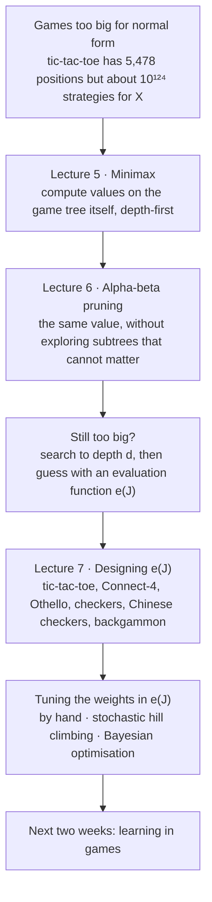
<table header-row="true">
<tr>
<td>Lecture</td>
<td>Lecturer</td>
<td>Topic</td>
<td>Reading</td>
<td>In these notes</td>
</tr>
<tr>
<td>5 (26 slides)</td>
<td>Mingfei Sun</td>
<td>The minimax algorithm: what it computes, how to implement it, when it gives equilibria and when it does not</td>
<td>Lecture 5 handout (Schalk, Chapter 3)</td>
<td>Part A</td>
</tr>
<tr>
<td>6 (20 slides)</td>
<td>Mingfei Sun</td>
<td>Alpha–beta pruning: windows, update rules, correctness; evaluation functions</td>
<td>Lecture 6 handout (Schalk, Chapter 3)</td>
<td>Part B</td>
</tr>
<tr>
<td>7 (41 slides)</td>
<td>Jonathan Shapiro</td>
<td>Alpha–beta worked examples; heuristics for real games; tuning heuristics by hill climbing and Bayesian optimisation; the history of game-playing programs</td>
<td>Schalk, Chapter 3 (for the lecture) and Chapter 4 (for the week)</td>
<td>Part C</td>
</tr>
<tr>
<td>–</td>
<td>–</td>
<td>The handout exercises solved, practice trees, self-test, cheat sheet, errata, further reading</td>
<td>–</td>
<td>Part D</td>
</tr>
</table>
<callout icon="⭐" color="yellow_bg">
	**The whole week in eight sentences**
	1. A game tree is enormously smaller than the list of strategies it generates, so we compute directly on the tree.
	2. **Minimax:** the value of a position is the *maximum* of its children's values if it is your move, the *minimum* if it is the opponent's move, and the *probability-weighted average* at a chance move, computed recursively up from the final positions.
	3. It is programmed **depth-first**, so memory holds only the current path; it still visits every node once.
	4. In **two-player zero-sum games of perfect information** the minimax values and choices *are* the equilibrium. In general-sum games they are only **security levels** (what each player can guarantee), and with **imperfect information** plain minimax does not apply.
	5. **Alpha–beta** passes down a window $`(\alpha, \beta)`$ of values that could still matter, and abandons a node as soon as its value is known to lie outside the window. It returns exactly the minimax value.
	6. How much it saves depends on **move ordering**: with the best move tried first it reads about $`b^{d/2}`$ leaves instead of $`b^{d}`$, so the same effort searches twice as deep.
	7. Real games are too deep even for alpha–beta, so programs search to a fixed depth and score the frontier with a **heuristic evaluation function**, treated as if it were the true value.
	8. Good evaluation functions are **weighted combinations of features** (open lines, mobility, corners, material, …), and the weights are tuned by hand, by **stochastic hill climbing**, or by **Bayesian optimisation**, each candidate being judged by playing games: an expensive black box.
</callout>
## What to read, and what I could not open
<callout icon="📖" color="orange_bg">
	**The reading for this week, and how it is covered here**
	- **Lecture 5 and Lecture 6 handouts** ("adapted from notes by Andrea Schalk": they are the minimax and alpha–beta sections of Schalk's Chapter 3). Covered completely in Parts A and B, including both exercises, which are solved in Part D.
	- **Schalk, Chapter 4** (*Large games* / *Game-playing programs*). Lecture 7's slide 3 sets it as the reading for the week, and slide 41 sends you there for opening books, endgame databases and move ordering. **I could not open it**: the university web server ([cs.man.ac.uk](http://cs.man.ac.uk)) is blocked from the environment I worked in. Part C and Part B's move-ordering section explain those techniques from standard sources, marked ➕ *beyond the slides*. Read the chapter yourself for Schalk's own examples and history: [Section 4, Large Games](http://www.cs.man.ac.uk/~schalk/3192/large.pdf) and the full [COMP34120 notes](http://www.cs.man.ac.uk/~schalk/34120/notes.pdf).
	- **Chess Programming Wiki** (slide 41). The pages worth reading are listed at the end of Part D.
</callout>
# Part A · Lecture 5: The minimax algorithm
Mingfei Sun · 26 slides · handout *Lecture 5: Minimax Algorithm*, adapted from Schalk's notes {color="gray"}
## A1 · Why we need algorithms that work on the tree
Lecture 5 · slides 2–3 · handout p. 1 {color="gray"}
There are two ways to write a game down, and this week is about switching from one to the other.
- The **extensive form** is the *game tree*. Every node is a position; every edge leaving it is a move; each node says whose turn it is (or that a chance event happens there, with probabilities on its edges); each leaf is a final position labelled with the pay-off to every player. Hidden information is shown by *information sets*: groups of nodes the player to move cannot tell apart.
- The **normal form** is a table. Each row is a *strategy* of Player 1, each column a strategy of Player 2, and each cell holds the pay-offs when those two strategies meet.
The key word is *strategy*. A strategy in a game tree is not a single move but a **complete plan**: it says which move the player will make at *every* position where it might have to move. Weeks 2 and 3 solved games in normal form (dominance, best responses, maximin, the indifference principle). Slide 2 explains why that cannot work for chess, checkers or Go:
1. A tree whose moves branch $`b`$ ways and which is $`h`$ moves deep has about $`b^h`$ leaves, so the **size of the tree is exponential in its height**.
2. A strategy chooses one move at each of the player's decision nodes, and these choices combine freely, so the **number of strategies is roughly exponential in the size of the tree**: exponential in something that is already exponential.
<callout icon="🧮" color="gray_bg">
	**How big is "too big"? Tic-tac-toe, counted exactly.** (Computed for these notes; the program is in the repository.)
	- Complete games (move sequences to the end): **255,168**.
	- Different positions that can occur: **5,478**.
	- Strategies for X: count them recursively. At a node where X moves, a plan picks exactly *one* child, so the number of plans is the **sum** over the children. At a node where O moves, X's plan must say what to do after *every* reply, and the plans for different replies combine independently, so the number is the **product** over the children:
	$$
	N_X(J)=\begin{cases}1 & J \text{ is a final position}\\ \sum_k N_X(J_k) & \text{X moves at } J\\ \prod_k N_X(J_k) & \text{O moves at } J\end{cases}
	$$
	- Result: X has about $`1.4 \times 10^{124}`$ strategies and O about $`10^{443}`$, even counting only instructions for positions the plan itself can reach. The normal form would need $`10^{124} \times 10^{443}`$ cells; the game tree has a few thousand distinct positions. Products of products are what make strategies explode.
</callout>
So the solution (slide 2) is **algorithms that work directly on the extensive form**. Slide 3 names the two this week:
1. The **minimax algorithm** finds *certain solutions*, which are not necessarily equilibria (A7 shows exactly when they are not), by working recursively on the tree.
2. **Alpha–beta pruning** is an optimised minimax that avoids searching the whole tree (Part B).
Both are also the workhorses for finding *good* strategies when a game is too large to solve completely, which is the story of Lecture 7.
<callout icon="➕" color="gray_bg">
	**Where the algorithm comes from.** The handout says it starts from "the proof of Theorem ?? and Proposition ??" (the ?? are broken cross-references in the handout). Those are results from earlier in Schalk's notes: in a finite game like chess, either one player can force a win or both can force a draw (Zermelo's theorem, 1913), and more generally each player has a highest pay-off it can guarantee. Both are proved by induction on the tree, from the leaves up. Minimax is that induction turned into a program. Chess has around $`10^{44}`$ legal positions and, by Claude Shannon's famous 1950 estimate, around $`10^{120}`$ possible games, which is why even minimax will not be enough there.
</callout>
## A2 · What minimax computes: the value
Lecture 5 · slides 6 and 8 · handout pp. 1–2 {color="gray"}
<callout icon="📘" color="blue_bg">
	**Value of a two-person zero-sum game.** The largest expected pay-off that Player 1 can **guarantee** for itself, whatever Player 2 does. Its negative is the largest expected pay-off Player 2 can guarantee.
</callout>
Each word matters.
- **Guarantee** means: there is a strategy for Player 1 that gets at least this much against *every* strategy of Player 2, including the most hostile one.
- **Largest** means: no strategy guarantees more.
- **Expected** is there because of chance moves (dice, shuffled cards). If chance is involved, a guarantee can only be about the average pay-off.
- **Zero-sum** means Player 2's pay-off is always minus Player 1's. So Player 2 "doing the worst thing for Player 1" and "doing the best thing for itself" are the *same* behaviour. That is why one number describes both players.
This is last week's maximin idea, moved from tables to trees: Player 1 maximises, over its own choices, the minimum it can be held to. The new part is *how* it is computed. Instead of listing strategies, minimax finds the value of the whole game by finding the value of every **sub-game**, the game that starts at each position.
The same question makes sense in any game, with any number of players:
<callout icon="📘" color="blue_bg">
	**Value of the game for Player i** (slide 8). The largest expected pay-off Player $`i`$ can guarantee for itself, **even in the worst case**, that is, whatever all the other players do. Also called Player $`i`$'s *security level*. In a two-person zero-sum game, the value for Player 1 is the value of the game, and the value for Player 2 is its negative.
</callout>
## A3 · The minimax rule
Lecture 5 · slides 7, 12 and 18 · handout pp. 1–3 {color="gray"}
To know what Player $`i`$ can guarantee from a position, we need to know what it can guarantee from each position one move later, and so on down to the end of the game, where the pay-off is simply read off. Write $`U_i(J)`$ for Player $`i`$'s pay-off at a final position $`J`$, and $`J_1, \dots, J_k`$ for the children of a node $`J`$. Slide 7's rule, written out in full:
<callout icon="⭐" color="yellow_bg">
	**The minimax rule** for Player $`i`$:
	$$
							v_i(J)=\begin{cases}
U_i(J) & \text{if } J \text{ is a final position}\\[2pt]
\max_{j}\; v_i(J_j) & \text{if it is Player } i\text{'s turn at } J\\[2pt]
\min_{j}\; v_i(J_j) & \text{if it is another player's turn at } J\\[2pt]
\sum_{j} q_j\, v_i(J_j) & \text{if } J \text{ is a chance move that picks child } j \text{ with probability } q_j
\end{cases}
	$$
	The value of the game for Player $`i`$ is $`v_i(\text{root})`$.
</callout>
Read it line by line.
- **Final position:** nothing is left to decide; the pay-off is what it is.
- **Player i's turn:** Player $`i`$ will pick whichever move is best for itself, so the position is worth the *best* of its children.
- **Another player's turn:** we do not assume the other player is clever or stupid, kind or cruel. To *guarantee* something we must survive anything they might do, so we assume the *worst* child for Player $`i`$.
- **Chance move:** nobody controls the dice, so the position is worth the *expected* value: each child weighted by its probability.
**Why "minimax"** (slide 18): the algorithm alternates between taking **max**ima at the maximising player's nodes and **min**ima at the minimising player's nodes. In a two-person zero-sum game Player 1 maximises and Player 2 minimises Player 1's pay-off; the names *MAX* and *MIN* for the two players come from here.
**From values to strategies** (slide 8): if at each node where it is Player $`i`$'s turn we *remember which child gave the maximum*, the remembered choices form a strategy, and following it guarantees Player $`i`$ at least $`v_i(\text{root})`$ whatever the others do. Several children may tie for the maximum; any of them will do.
**More than two players, or non-zero-sum** (slide 7): nothing in the rule needs two players or zero-sum pay-offs. In a non-zero-sum game you simply **run it once for each player**, each time using that player's pay-offs at the leaves and putting max at that player's nodes and min at everybody else's.
<callout icon="🧮" color="gray_bg">
	**The node type changes the decision.** Player 1 chooses between a *safe* move worth 1 and a *risky* move leading to a node with two outcomes, worth 4 and −1.
	- If the risky node is a **fair coin flip**: it is worth $`\tfrac12(4) + \tfrac12(-1) = 1.5 > 1`$, so Player 1 takes the risk, and the value is 1.5.
	- If the risky node is **the opponent's choice**: it is worth $`\min(4, -1) = -1 < 1`$, so Player 1 plays safe, and the value is 1.
	Same leaves, different node type, different decision.
</callout>
<callout icon="💡" color="purple_bg">
	**Minimax is a paranoid planner.** It plans as if every other player were out to hurt it. Against a true opponent in a zero-sum game that is exactly right (A6). Against players who are just pursuing their own goals it is safe but pessimistic (A7).
</callout>
## A4 · Worked example: the Lecture 5 tree, bottom-up
Lecture 5 · slide 13 · handout Figure 1 {color="gray"}
The tree used throughout Lecture 5: Player 1 (MAX) moves first, with three options: go to node **A**, take a final position worth **−1**, or go to node **C**. At **A** Player 2 (MIN) chooses between a final position worth **4**, node **B1** and node **B2**, where Player 1 moves again: **B1** leads to 1 or 2, **B2** to −1, 2 or 1. At **C** Player 2 chooses between 2 and −2. All numbers are Player 1's pay-offs; the game is zero-sum, so Player 2's are their negatives.
The **bottom-up** approach starts at the leaves, whose values are known, and repeatedly evaluates any node whose children all have values, until it reaches the root.
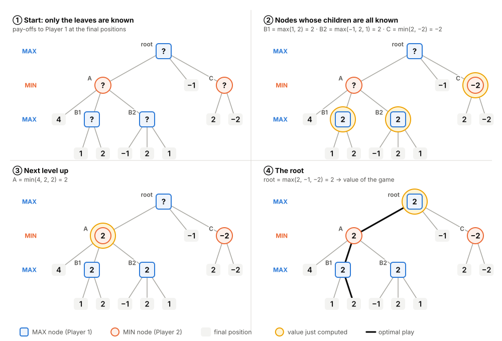
<table header-row="true">
<tr>
<td>Step</td>
<td>Node</td>
<td>Whose move</td>
<td>Children's values</td>
<td>Rule</td>
<td>Value</td>
</tr>
<tr>
<td>1</td>
<td>B1</td>
<td>Player 1 (MAX)</td>
<td>1, 2</td>
<td>max</td>
<td>**2**</td>
</tr>
<tr>
<td>2</td>
<td>B2</td>
<td>Player 1 (MAX)</td>
<td>−1, 2, 1</td>
<td>max</td>
<td>**2**</td>
</tr>
<tr>
<td>3</td>
<td>C</td>
<td>Player 2 (MIN)</td>
<td>2, −2</td>
<td>min</td>
<td>**−2**</td>
</tr>
<tr>
<td>4</td>
<td>A</td>
<td>Player 2 (MIN)</td>
<td>4, 2, 2</td>
<td>min</td>
<td>**2**</td>
</tr>
<tr>
<td>5</td>
<td>root</td>
<td>Player 1 (MAX)</td>
<td>2, −1, −2</td>
<td>max</td>
<td>**2**</td>
</tr>
</table>
**Reading off the answer.** The value of the game is **2**.
- Player 1's strategy that guarantees 2: move to A; at B1 take the leaf worth 2; at B2 take the middle leaf worth 2. Check the guarantee: whatever Player 2 does at A, Player 1 gets 4 (leaf), 2 (via B1) or 2 (via B2), never less than 2.
- Player 2's strategy that holds Player 1 to 2: at A move to B1 or B2 (they tie, both worth 2; never the leaf worth 4); at C take −2.
- Why not the other first moves? The middle move gives only −1, and C gives −2 because Player 2 would choose −2 there.
<callout icon="⚠️" color="red_bg">
	**On the slide.** In panel 4 of slide 13 (and of the handout's Figure 1), node B1 is drawn with "?" again although its value 2 was found in panel 2. It is a drawing slip: once found, a value never changes. The small numbers 1–4 in the corners of the panels are panel numbers, not values.
</callout>
## A5 · Implementing minimax: bottom-up versus depth-first
Lecture 5 · slides 12, 14–17 and 19 · handout pp. 3–6 {color="gray"}
Slide 12 states the algorithm recursively: to find the value of a position, find the values of all its immediate successors; to find those, find the values of *their* successors; continue until final positions, where the pay-off function gives the value. There are two ways to organise this work.
**Why bottom-up is impractical** (slide 14). A program does not have the tree drawn out. It has the root position and either links to the children, or (much more often) a *function that generates the children* of a position: the rules of the game. To work bottom-up it would first have to find all the leaves, traversing much of the tree several times, visiting many positions repeatedly, and holding very many values in memory at once (a whole level of the tree, up to $`b^d`$ numbers).
**Depth-first** (slide 15) works *down* from the root to find leaves and computes values *on the way back up*, keeping only the current path in memory:
1. Start at the root and move to its first child.
2. Explore that child's subtree completely (by the same procedure).
3. This gives the child's value.
4. Move to the next sibling.
5. Repeat until all children have been visited.
6. Combine the children's values (max, min or average) into the current node's value, and return it to the parent.

Slides 16–17 animate this on the same tree in 11 frames (dashed arrows trace the search). Frame by frame:
<table header-row="true">
<tr>
<td>Frame</td>
<td>What happens</td>
<td>Values known after the frame</td>
</tr>
<tr>
<td>1</td>
<td>Start at the root; nothing is known except that leaves can be read when reached.</td>
<td>–</td>
</tr>
<tr>
<td>2</td>
<td>Move down to the first child, A (Player 2's node).</td>
<td>–</td>
</tr>
<tr>
<td>3</td>
<td>From A, visit the leaf 4 and come back; go down to B1.</td>
<td>leaf 4</td>
</tr>
<tr>
<td>4</td>
<td>Visit B1's leaves 1 and 2.</td>
<td>1, 2</td>
</tr>
<tr>
<td>5</td>
<td>Back at B1: max(1, 2).</td>
<td>B1 = 2</td>
</tr>
<tr>
<td>6</td>
<td>Back to A, then down to B2.</td>
<td>B1 = 2</td>
</tr>
<tr>
<td>7</td>
<td>Visit −1, 2, 1; back at B2: max.</td>
<td>B2 = 2</td>
</tr>
<tr>
<td>8</td>
<td>Back at A: all three children known; min(4, 2, 2).</td>
<td>A = 2</td>
</tr>
<tr>
<td>9</td>
<td>Back at the root; visit the middle leaf −1; go down to C.</td>
<td>A = 2, −1</td>
</tr>
<tr>
<td>10</td>
<td>Visit 2 and −2; back at C: min.</td>
<td>C = −2</td>
</tr>
<tr>
<td>11</td>
<td>Back at the root: max(2, −1, −2).</td>
<td>root = 2</td>
</tr>
</table>
<callout icon="📖" color="orange_bg">
	**Look at slides 16–17** (or Figures 2–3 of the handout) with this table beside you. The dashed arrows show the search going down and coming back up; a value appears at a node exactly when the search leaves it for the last time.
</callout>
As code, depth-first minimax is just the recursive rule. The program's call stack *is* the current path:
```python
def minimax(J):
    """Value of position J for MAX, searching to the end of the game."""
    if J.is_final():
        return J.payoff()                          # U(J): read off the pay-off
    if J.to_move() == "chance":
        return sum(q * minimax(child) for q, child in J.chance_children())
    values = [minimax(J.play(m)) for m in J.moves()]   # children generated one at a time
    return max(values) if J.to_move() == "MAX" else min(values)


def best_move(J):
    """MAX's choice at J: the move whose resulting position has the largest value."""
    return max(J.moves(), key=lambda m: minimax(J.play(m)))
```
<table header-row="true">
<tr>
<td></td>
<td>Bottom-up</td>
<td>Depth-first (minimax as programmed)</td>
</tr>
<tr>
<td>Needs the whole tree stored?</td>
<td>Yes, or regenerates parts repeatedly</td>
<td>No: generates children as it goes</td>
</tr>
<tr>
<td>Time</td>
<td>Every node, often more than once</td>
<td>Every node exactly once: about $`b^d`$ leaves</td>
</tr>
<tr>
<td>Memory</td>
<td>Whole levels of values: up to $`b^d`$</td>
<td>The current path: about $`d`$ nodes (about $`b \cdot d`$ if each keeps its list of moves)</td>
</tr>
<tr>
<td>Good for</td>
<td>Solving small trees by hand</td>
<td>Programs</td>
</tr>
</table>
**Data-structure choice** (slide 19). If each node knows only its children and its parent, the search must go back to the parent to get from one child to the next sibling (Figures 2–3 of the handout draw exactly this). If nodes also know their siblings, the search can step sideways directly, which is faster but needs more memory. A trade-off between time and space; in a recursive program the "go back to the parent" step is simply returning from a function call.
<callout icon="🎯" color="green_bg">
	**Answering "carry out the minimax algorithm on this tree".** Write the value next to every internal node, working from the leaves up; state the value of the root; state each player's optimal choice at each of its nodes (and mention ties). If the question says *depth-first*, also give the order in which nodes are visited, or in which their values become final.
</callout>
## A6 · Two-person zero-sum games: minimax finds the equilibrium
Lecture 5 · slides 20–21 · handout pp. 6–7 {color="gray"}
<callout icon="⭐" color="yellow_bg">
	**Theorem** (slide 21). For two-person zero-sum games of **perfect information**, minimax finds **equilibrium strategies**:
	- the value for Player 1 is the value of the game, and the value for Player 2 is its negative;
	- the strategies it identifies (the remembered choices) form a **Nash equilibrium**;
	- if both players play them, the outcome is exactly the value.
</callout>
**Why it is true**, in three steps. Let $`v`$ be the value at the root, $`s^*`$ Player 1's remembered choices and $`t^*`$ Player 2's.
1. $`s^*`$** guarantees Player 1 at least **$`v`$ against *every* strategy of Player 2. That is how it was built: at every Player 2 node we assumed the worst.
2. $`t^*`$** holds Player 1 to at most **$`v`$ against every strategy of Player 1. Running minimax for Player 2 on Player 2's pay-offs $`-U`$ is the same computation with the signs flipped: maximising $`-U`$ is minimising $`U`$. So Player 2's minimax choices are exactly the MIN choices of Player 1's computation.
3. So $`(s^*, t^*)`$ gives exactly $`v`$, and **neither player can gain by changing alone**: if Player 1 deviates while Player 2 keeps $`t^*`$, Player 1 gets at most $`v`$ by step 2; if Player 2 deviates while Player 1 keeps $`s^*`$, Player 1 gets at least $`v`$ by step 1, so Player 2 gets at most $`-v`$. That is the definition of a Nash equilibrium.
<callout icon="💡" color="purple_bg">
	**Here the paranoia is accurate.** In a zero-sum game, what is worst for Player 1 is best for Player 2, so assuming the opponent does the worst for you is assuming the opponent plays well. The pessimistic assumption and the rational assumption coincide.
</callout>
The handout draws the practical conclusion: we can find equilibria of a two-person zero-sum game of perfect information **without ever listing the strategies**, as long as we record the decisions that lead to the value. After the tic-tac-toe count in A1, that is a big deal.
<callout icon="➕" color="gray_bg">
	**Beyond the slides.** (1) The strategies minimax finds are optimal at *every* node, including nodes off the actual path of play, which makes them a *subgame-perfect* equilibrium. (2) Chance moves cause no trouble: with the averaging rule, minimax (often called *expectiminimax* then) still finds the equilibrium of zero-sum games with dice, such as backgammon. (3) The theorem shows that every finite two-person zero-sum game of perfect information has an equilibrium in **pure** strategies. Compare Week 3: mixed strategies were needed only because something was hidden.
</callout>
## A7 · General-sum games: values are guarantees, not predictions
Lecture 5 · slides 9–10 and 22 · handout pp. 2–3, Question 2 and Exercise 1 {color="gray"}
<callout icon="⚠️" color="red_bg">
	**Important limitation** (slide 9). In general (non-zero-sum) games, the value minimax computes for a player does **not** necessarily equal that player's pay-off in any equilibrium. Minimax calculates the "best choice that maximises the pay-off in the worst case", so it implicitly assumes the other players will play to *minimise our* pay-off. In reality they maximise *their own*. The two objectives coincide only in two-person zero-sum games.
</callout>
The handout's Exercise 1 shows this on a game with the same shape as the Lecture 5 tree, but with pay-offs written (Player 1, Player 2):
- At the root, Player 1 chooses **X**, a final position **(−1, 4)**, or **Z**.
- At **X**, Player 2 chooses a final position **(4, 3)**, node **Y1**, or node **Y2**.
- At **Y1**, Player 1 chooses (1, −1) or (2, −2). At **Y2**, Player 1 chooses (−1, 3), (2, −2) or (1, 2).
- At **Z**, Player 2 chooses (2, 3) or (−2, 4).
The exercise: carry out minimax for each player; find the values and the strategies; say what happens when the players use these strategies against each other.

<table header-row="true">
<tr>
<td>Node</td>
<td>Player 1's computation (first numbers)</td>
<td>Player 2's computation (second numbers)</td>
</tr>
<tr>
<td>Y1 (Player 1 moves)</td>
<td>max(1, 2) = **2**: take (2, −2)</td>
<td>Player 1 might hurt Player 2: min(−1, −2) = **−2**</td>
</tr>
<tr>
<td>Y2 (Player 1 moves)</td>
<td>max(−1, 2, 1) = **2**: take (2, −2)</td>
<td>min(3, −2, 2) = **−2**</td>
</tr>
<tr>
<td>X (Player 2 moves)</td>
<td>Player 2 might hurt Player 1: min(4, 2, 2) = **2**</td>
<td>max(3, −2, −2) = **3**: take (4, 3)</td>
</tr>
<tr>
<td>Z (Player 2 moves)</td>
<td>min(2, −2) = **−2**</td>
<td>max(3, 4) = **4**: take (−2, 4)</td>
</tr>
<tr>
<td>root (Player 1 moves)</td>
<td>max(2, −1, −2) = **2**: go to X</td>
<td>min(3, 4, 4) = **3**</td>
</tr>
</table>
**Answer.**
- **Player 1's value is 2.** Strategy: go to X; at Y1 and at Y2 take (2, −2).
- **Player 2's value is 3.** Strategy: at X take (4, 3); at Z take (−2, 4).
- **Played against each other:** Player 1 goes to X, and Player 2 immediately ends the game at **(4, 3)**. Player 1 gets **4**, twice its value; Player 2 gets exactly its value, 3.
Why does Player 1 do so much better than its "value"? Its computation assumed that at X, Player 2 might move to Y1 or Y2, accepting −2 for itself just to keep Player 1 down to 2. A real Player 2 cares about its own pay-off, prefers 3 to −2, and takes (4, 3), which happens to be excellent for Player 1. **The value is a floor, not a forecast.** Here Player 1's minimax value (2) is not its equilibrium pay-off (4), which is precisely slide 9's point. (In this game the two security strategies happen also to form an equilibrium: solving the tree with each player maximising their *own* pay-off gives the same outcome (4, 3). That is luck, not a rule.)
**The "obvious" fix fails** (slide 10). Why not let the other player maximise *its own* pay-off instead of minimising ours? Because the other player may have **several moves that are equally good for it but very different for us**, and then the rule does not say which one it picks:
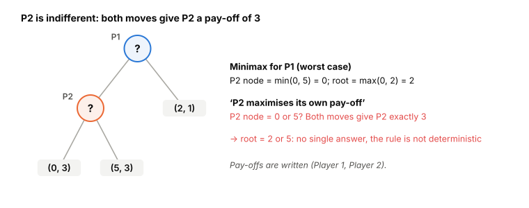
There is no sensible way to choose between such moves, so the alternative algorithm is non-deterministic. The slide's conclusion: the worst-case minimax approach is the most practical.
<callout icon="➕" color="gray_bg">
	**Beyond the slides.** The "alternative algorithm" is *backward induction*, which finds *subgame-perfect equilibria* of perfect-information games. Ties are exactly why a general-sum game can have several subgame-perfect equilibria with different pay-offs. Programs that use it must fix a tie-breaking rule, and the answer then depends on that rule.
</callout>
**Question 2 of the handout** (slide 22): what are the advantages and disadvantages of following minimax play in a two-person **general-sum** game?
<table header-row="true">
<tr>
<td>Advantages</td>
<td>Disadvantages</td>
</tr>
<tr>
<td>It is a **security strategy**: you are guaranteed at least your value whatever the opponent does, even if the opponent is irrational or makes mistakes.</td>
<td>It can be **overly conservative**: it gives up good outcomes that rely only on the opponent pursuing its own interests (example below).</td>
</tr>
<tr>
<td>It **works when an equilibrium is hard to find**, or when there are several equilibria and you do not know which one the opponent is aiming for.</td>
<td>It **does not find equilibrium pay-offs**: the value can be far below what you would actually get (4 against a value of 2 above).</td>
</tr>
<tr>
<td>It needs **only your own pay-offs**: Player 1's computation above never used a second number. Useful if you do not know what the opponent wants.</td>
<td>It **assumes the opponent is adversarial**, which in a general-sum game is usually false: the opponent may even benefit from the same outcome as you.</td>
</tr>
</table>
<callout icon="🧮" color="gray_bg">
	**Over-conservatism in one line.** Player 1 chooses between a safe final position (1, 0) and a Player 2 node offering (5, 5) or (−10, 0). Player 2 obviously prefers (5, 5), so Player 1 would get 5. But minimax for Player 1 values Player 2's node at $`\min(5, -10) = -10`$ and plays safe for 1, giving away 4.
</callout>
## A8 · Imperfect information: why plain minimax breaks
Lecture 5 · slides 23–24 · handout p. 7, Question 1 {color="gray"}
<callout icon="⚠️" color="red_bg">
	**The minimax algorithm as described does not directly apply to games of imperfect information** (slide 23).
</callout>
Recall that an *information set* is a group of positions that the player to move cannot tell apart; all of them must offer the same moves, since otherwise the player could tell them apart by looking at the moves. Minimax needs a value for "the position we are in". In an information set the positions have the same *immediate* moves but lead to different trees "down the line", and so to different pay-offs. A good decision cannot be made without knowing which position we are in. Card games are the typical example: you know only your own hand, so your possible moves look the same whatever the others hold, but the eventual pay-off depends on everybody's hand, and the difference between positions in the same information set is typically huge (compare Week 3's poker).
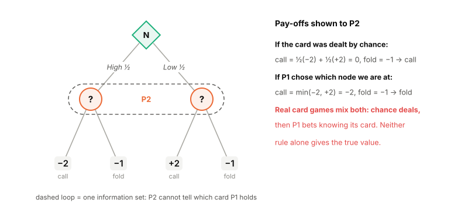
**Possible adjustments** (slide 24 and the handout), depending on *why* Player $`i`$ is uncertain about the position:
- **The uncertainty comes from a chance move:** take the **expected** pay-off over the positions in the information set, weighted by their probabilities. In Figure A5, calling is worth $`\tfrac12(-2) + \tfrac12(+2) = 0`$ against −1 for folding, so call.
- **The uncertainty comes from another player's move:** take the **worst-case** pay-off for Player $`i`$ over the positions, since that player may have steered us to the worst one. In Figure A5, if Player 1 had *chosen* the node, calling is worth $`\min(-2, +2) = -2`$ against −1, so fold.
<callout icon="⚠️" color="red_bg">
	**The catch** (slide 24). In practice the uncertainty usually comes from **both at once**: the cards are dealt by chance, and then the other player bets *knowing* its card, so its bet carries information. Neither rule is then right, and the algorithm no longer computes the value as defined. This needs the equilibrium analysis of Week 3, where the answer turned out to involve mixed strategies and bluffing.
</callout>
<callout icon="🎯" color="green_bg">
	**Question 1 of the handout:** *how could the algorithm be adapted to cope with a game of imperfect information?* Answer: treat each information set as one decision; if the uncertainty about which node you are in is due to chance, use the expected pay-off over the nodes; if it is due to another player's move, use the worst case; and point out that when both sources mix (as in card games) this no longer gives the true value, so a proper equilibrium (possibly mixed) analysis is needed.
</callout>
<callout icon="➕" color="gray_bg">
	**Beyond the slides.** Modern programs for imperfect-information games, such as the poker programs Libratus (2017) and Pluribus (2019), do not use minimax; they compute approximate equilibria with methods such as counterfactual regret minimisation, which belong to the "learning in games" topics coming next.
</callout>
## A9 · Lecture 5 in brief
<table header-row="true">
<tr>
<td>Idea</td>
<td>In one line</td>
</tr>
<tr>
<td>Why trees</td>
<td>The number of strategies explodes (tic-tac-toe: about $`10^{124}`$ for X), the tree does not.</td>
</tr>
<tr>
<td>Value for Player i</td>
<td>The largest expected pay-off Player $`i`$ can guarantee whatever the others do.</td>
</tr>
<tr>
<td>Minimax rule</td>
<td>Leaf: pay-off. Own move: max. Other's move: min. Chance: probability-weighted average.</td>
</tr>
<tr>
<td>Strategy</td>
<td>Remember which child gave the max at each of your own nodes.</td>
</tr>
<tr>
<td>Implementation</td>
<td>Depth-first: down to the leaves, values on the way back up; time about $`b^d`$, memory about one path.</td>
</tr>
<tr>
<td>Zero-sum, perfect information</td>
<td>Minimax gives the value and Nash-equilibrium strategies.</td>
</tr>
<tr>
<td>General-sum</td>
<td>Run it per player; the values are security levels (floors), not equilibrium pay-offs.</td>
</tr>
<tr>
<td>Imperfect information</td>
<td>Not directly applicable: expected value for chance-caused uncertainty, worst case for player-caused, neither when both mix.</td>
</tr>
</table>
<details>
<summary>Check yourself: why is the value for Player 2 in a zero-sum game the negative of the value for Player 1, but not in the non-zero-sum exercise?</summary>
	In a zero-sum game Player 2's pay-off is $`-U_1`$ at every leaf, so Player 2 maximising its pay-off is the same as minimising Player 1's: the two computations are the same tree with signs flipped, giving $`v_2 = -v_1`$. In the exercise the second numbers are unrelated to the first, so the two computations are different (Player 1: 2; Player 2: 3), and $`3 \ne -2`$.
</details>
<details>
<summary>Check yourself: a MAX node has a chance child with outcomes 6 (probability ⅓) and 0 (probability ⅔), and a MIN child with leaves 3 and 2. What is its value, and which move is chosen?</summary>
	Chance child: $`\tfrac13 \cdot 6 + \tfrac23 \cdot 0 = 2`$. MIN child: $`\min(3, 2) = 2`$. The MAX node is $`\max(2, 2) = 2`$; the two moves tie, so either may be chosen.
</details>
<details>
<summary>Check yourself: why does a depth-first program not need the whole tree in memory?</summary>
	It generates the children of a position only when it reaches that position, and as soon as a child's value is known, the child's subtree can be forgotten: only the current path from the root (and a running max or min at each node on it) is needed.
</details>
# Part B · Lecture 6: Alpha–beta pruning
Mingfei Sun · 20 slides · handout *Lecture 6: Alpha-Beta Pruning*, adapted from Schalk's notes {color="gray"}
## B1 · Can we do better than visiting every leaf?
Lecture 6 · slides 2 and 5–6 · handout p. 1 {color="gray"}
Slide 2 recaps minimax: it finds values recursively; MAX nodes take the maximum of their children, MIN nodes the minimum, chance nodes the expected value; it works depth-first and **visits every leaf exactly once**. That looks optimal: how could you know a position's value without looking at all of it? The answer is that you often do not need to know the value of a position *exactly*. You only need to know enough to be sure it will not change the decision above it.
<callout icon="⭐" color="yellow_bg">
	**Key insight** (slide 5). Use the values calculated for sub-games **so far** to decide whether it is worthwhile to explore the other sub-games. The result, **alpha–beta pruning**, is an optimisation of minimax that avoids searching parts of the tree, returns **the same answer as minimax**, and can be **enormously faster** on large games.
</callout>
Slide 6: in small games drawn on paper the difference looks minor; in large games it is enormous, and real game-playing programs would be much less effective without it. Alpha–beta is used in virtually all competitive chess engines and in many other game programs.
## B2 · The idea on the smallest example
A standard example (from Russell and Norvig's *Artificial Intelligence: A Modern Approach*, the usual first picture of alpha–beta). MAX moves at the root and has three moves, to MIN nodes A, B and C, whose leaves are A: 3, 12, 8; B: 2, 4, 6; C: 14, 5, 2.
1. **A** is searched completely: $`\min(3, 12, 8) = 3`$. So MAX can already guarantee **at least 3** by moving to A.
2. **B**: the first leaf is 2. MIN chooses at B, so B is worth **at most 2**, whatever the other leaves are. MAX already has 3 elsewhere, so MAX will never move to B. B's other leaves (4 and 6) **cannot change anything**, and are never looked at.
3. **C**: 14 (C is at most 14), then 5 (at most 5), then 2 (at most 2): no saving here, because the small leaf came last.
4. The root is $`\max(3, \le 2, 2) = 3`$, the same as minimax, after reading **7 of the 9 leaves**.
<callout icon="💡" color="purple_bg">
	**The whole idea in one sentence.** If you already have an option worth 3, and you find that another option lets the opponent hold you to 2 or less, you do not care *how much* less: you will not take it. "At most 2" is all the information you need, and getting it took one leaf instead of three.
</callout>
Note also what step 3 shows: **the order in which moves are looked at decides how much is saved.** Had C's leaves come in the order 2, 5, 14, the first leaf would already have settled C. B9 returns to this.
## B3 · Alpha and beta: the window of values that still matter
Lecture 6 · slides 7 and 13 · Lecture 7 slide 6 {color="gray"}
The core mechanism (slide 7) is to **pass down ranges of relevant values**. At the root we know nothing: the value is somewhere in $`(-\infty, \infty)`$. As children are explored we learn bounds on the value; we pass these bounds down to deeper nodes; and if a subtree's value is found to fall outside the range of interest, we **stop searching it**. The two ends of the range get names:
<callout icon="📘" color="blue_bg">
	**Alpha** $`(\alpha)`$, the **lower bound** (slide 13): the best value that **MAX can already guarantee** on the path to the current node, using alternatives explored so far. It is updated only at MAX nodes and starts at $`-\infty`$.
	**Beta** $`(\beta)`$, the **upper bound**: the best value that **MIN can already guarantee** on the path to the current node, that is, the lowest value MIN can already hold MAX to. It is updated only at MIN nodes and starts at $`+\infty`$.
	We are only interested in values in the **window** $`[\alpha, \beta]`$.
</callout>
Why only values inside the window matter:
- If a node turns out to be worth **at most α**, some MAX ancestor already has an alternative worth at least $`\alpha`$, so MAX will steer away from this node; its exact value is irrelevant.
- If a node turns out to be worth **at least β**, some MIN ancestor already has an alternative that holds MAX to $`\beta`$, so MIN will steer away; again its exact value is irrelevant.
Lecture 7's reminder slide (slide 6) adds the bookkeeping rules: the window is passed **down unchanged** to each child; a child can **change the window of its parent** when it returns its value; **only MAX nodes change α** and **only MIN nodes change β**; and a subtree is pruned as soon as $`\beta \le \alpha`$ at a node, because then no value can be in the window any more.
## B4 · The update rules
Lecture 6 · slide 14 · handout table on p. 6 {color="gray"}
When the search returns a value $`v`$ from a child, the node compares $`v`$ with its window and does one of six things:
<table header-row="true" header-column="true">
<tr>
<td>Value v returned by the child</td>
<td>At a MAX node</td>
<td>At a MIN node</td>
</tr>
<tr>
<td>$`v \le \alpha`$</td>
<td>ignore v and move on to the next child</td>
<td><span color="red">**value of the current node is irrelevant: return to parent**</span></td>
</tr>
<tr>
<td>$`\alpha < v < \beta`$</td>
<td>set $`\alpha`$ to v and move on to the next child</td>
<td>set $`\beta`$ to v and move on to the next child</td>
</tr>
<tr>
<td>$`\beta \le v`$</td>
<td><span color="red">**value of the current node is irrelevant: return to parent**</span></td>
<td>ignore v and move on to the next child</td>
</tr>
</table>
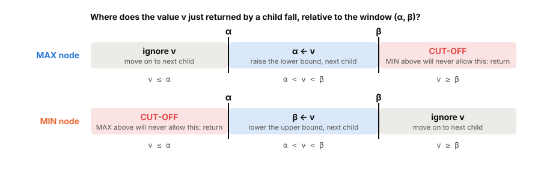
Each cell has a reason:
- **MAX node, v ≤ α: ignore.** MAX would get at most $`v`$ from this child, but some MAX ancestor can already guarantee $`\alpha \ge v`$. The child is no improvement. Other children might still be, so carry on.
- **MAX node, α \< v \< β: raise α.** A genuinely new best option for MAX that is still acceptable to MIN higher up. MAX can now guarantee $`v`$ here.
- **MAX node, v ≥ β: cut-off.** This node is worth at least $`v \ge \beta`$ to MAX. But a MIN ancestor already has an alternative that holds MAX to $`\beta`$, so MIN will never let play reach this node. Its remaining children cannot matter: return at once. (This is often called a *beta cut-off*.)
- **MIN node, v ≤ α: cut-off.** This node is worth at most $`v \le \alpha`$ to MAX. A MAX ancestor already has an alternative worth $`\alpha`$, so MAX will never come here. Return at once (an *alpha cut-off*).
- **MIN node, α \< v \< β: lower β.** A new best option for MIN that MAX higher up would still accept.
- **MIN node, v ≥ β: ignore.** MIN can already hold MAX to $`\beta \le v`$ on this path; the child is no better for MIN.
The two tables are mirror images: what MAX ignores at the bottom, MIN cuts at; what MAX cuts at the top, MIN ignores. Shapiro states all six cells as a single test, after updating: **if β ≤ α, stop**.
When a node has looked at all its children without a cut-off, it returns its $`\alpha`$ (MAX) or $`\beta`$ (MIN) to its parent. When it stops at a cut-off, it returns the $`v`$ that caused it. Either way the parent receives a number it can feed into the same table.
<callout icon="⚠️" color="red_bg">
	**Equality cuts.** The cut-off conditions are $`v \ge \beta`$ and $`v \le \alpha`$, **with equality**. If a node can only *tie* with an alternative already available higher up, its exact value cannot change any decision, so it may be cut. Forgetting the equality is the most common way to prune too little in an exam answer. (B6 has an example.)
</callout>
## B5 · The Lecture 6 example, step by step
Lecture 6 · slides 8–11 · handout Figures 1–9 {color="gray"}
The handout's example tree is only partly drawn: dotted parts are subtrees whose contents we never need. The root is MAX with three children: **A** (MIN), a second child whose subtree eventually turns out to be worth **1**, and **E** (MIN). Under A: a leaf **4**, then **B** (MAX), then **D** (MAX). Under B: a leaf **−2**, then **C** (MIN), whose first child is **−4**. D's first child turns out to be worth **1**; E's first child is **−1**.
<table header-row="true">
<tr>
<td>Step</td>
<td>Node and window on entry</td>
<td>What we learn</td>
<td>Action (rule from B4)</td>
</tr>
<tr>
<td>1</td>
<td>root $`(-\infty, \infty)`$</td>
<td>Nothing yet.</td>
<td>Pass the window down to A.</td>
</tr>
<tr>
<td>2</td>
<td>A $`(-\infty, \infty)`$</td>
<td>First leaf: 4. A is a MIN node, so A ≤ 4.</td>
<td>$`\alpha < 4 < \beta`$: set β = 4. A's window is now $`(-\infty, 4]`$ (slide 9).</td>
</tr>
<tr>
<td>3</td>
<td>B $`(-\infty, 4]`$</td>
<td>First leaf: −2. B is MAX, so B ≥ −2.</td>
<td>Set α = −2. B's window is $`[-2, 4]`$ (slide 10).</td>
</tr>
<tr>
<td>4</td>
<td>C $`[-2, 4]`$</td>
<td>First leaf: −4. C is MIN, so C ≤ −4.</td>
<td>$`-4 \le \alpha = -2`$ at a MIN node: **cut-off**. C's other children are never visited (slide 11, "Prune!").</td>
</tr>
<tr>
<td>5</td>
<td>back at B</td>
<td>C returned −4 (really: "at most −4").</td>
<td>$`-4 \le \alpha`$ at a MAX node: ignore. No children left: **B = −2**.</td>
</tr>
<tr>
<td>6</td>
<td>back at A</td>
<td>B returned −2.</td>
<td>$`-2 < \beta = 4`$: set β = −2. A's window is now $`(-\infty, -2]`$.</td>
</tr>
<tr>
<td>7</td>
<td>D $`(-\infty, -2]`$</td>
<td>First child is worth 1. D is MAX, so D ≥ 1.</td>
<td>$`1 \ge \beta = -2`$ at a MAX node: **cut-off**. D's other children are never visited.</td>
</tr>
<tr>
<td>8</td>
<td>back at A</td>
<td>D returned 1 ("at least 1").</td>
<td>$`1 \ge \beta`$ at a MIN node: ignore. No children left: **A = −2**.</td>
</tr>
<tr>
<td>9</td>
<td>back at the root</td>
<td>A is worth −2: MAX can guarantee −2 by moving to A.</td>
<td>Set α = −2. Root window $`[-2, \infty)`$.</td>
</tr>
<tr>
<td>10</td>
<td>second child $`[-2, \infty)`$</td>
<td>Its subtree is searched and returns 1.</td>
<td>Set α = 1. Root window $`[1, \infty)`$.</td>
</tr>
<tr>
<td>11</td>
<td>E $`[1, \infty)`$</td>
<td>First child: −1. E is MIN, so E ≤ −1.</td>
<td>$`-1 \le \alpha = 1`$ at a MIN node: **cut-off**.</td>
</tr>
<tr>
<td>12</td>
<td>root</td>
<td>All children done.</td>
<td>**Value 1**; best move: the second child.</td>
</tr>
</table>
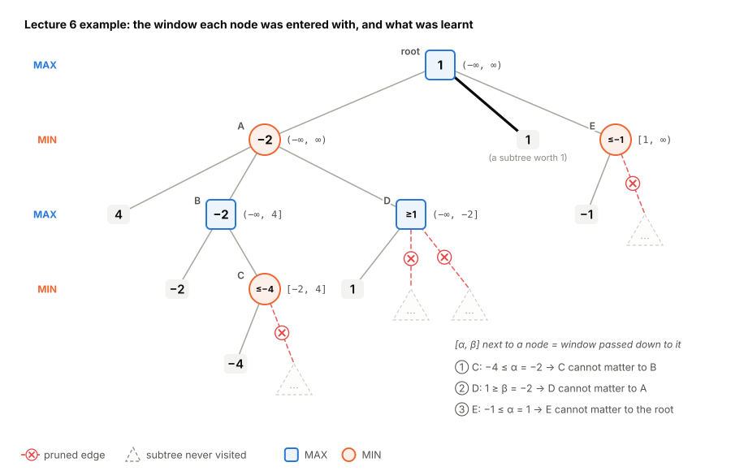
Three times the search learned a **bound** that was enough, and three times it skipped the rest of a subtree. C, D and E never got exact values; they did not need them.
<callout icon="📖" color="orange_bg">
	**The slides stop at step 4** (slides 8–11). The handout continues the example through Figures 5–9: read them alongside this table; each figure is one row or two.
</callout>
<callout icon="⚠️" color="red_bg">
	**Small errors in the source.** In the handout's Figure 9 the bottom level is labelled "max"; it is a MIN level (the levels alternate max, min, max, min). On slide 11 the leaf −2 under B collides with an arrowhead and reads as "−42". In the handout's text, "a value for D below −2 contribute to the value of A" means "*only* a value for D below −2 could contribute".
</callout>
## B6 · The Lecture 5 tree again, with alpha–beta
Applying the rules to the tree from Part A shows the equality cut in action.
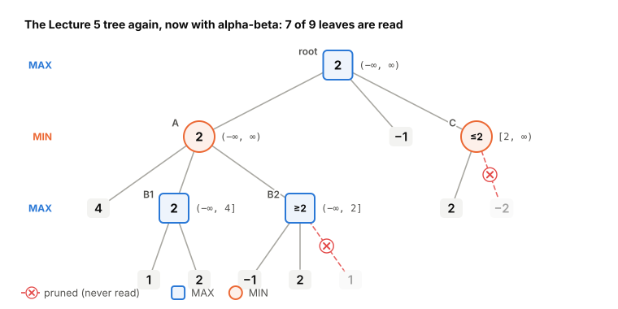
<table header-row="true">
<tr>
<td>Node (window on entry)</td>
<td>Leaves read, in order</td>
<td>Result</td>
</tr>
<tr>
<td>A $`(-\infty, \infty)`$</td>
<td>4</td>
<td>β = 4</td>
</tr>
<tr>
<td>B1 $`(-\infty, 4]`$</td>
<td>1, then 2</td>
<td>α = 1, then α = 2; B1 = 2, so A sets β = 2</td>
</tr>
<tr>
<td>B2 $`(-\infty, 2]`$</td>
<td>−1, then 2</td>
<td>α = −1; then $`2 \ge \beta = 2`$: **cut-off**, the last leaf (1) is never read</td>
</tr>
<tr>
<td>root, after A</td>
<td>–</td>
<td>A = 2, so α = 2</td>
</tr>
<tr>
<td>middle leaf</td>
<td>−1</td>
<td>$`-1 \le \alpha`$: ignore</td>
</tr>
<tr>
<td>C $`[2, \infty)`$</td>
<td>2</td>
<td>$`2 \le \alpha = 2`$: **cut-off**, the leaf −2 is never read</td>
</tr>
</table>
Value **2**, as before, after reading **7 of the 9 leaves**. Both cuts are *equality* cuts: B2 can only tie with B1 from A's point of view, and C can only tie with A from the root's point of view, so neither can change a decision.
## B7 · Alpha–beta as code
Lecture 6 · slides 13–14 {color="gray"}
The table translates line for line into code. The function takes the window as two extra arguments:
```python
import math

def alphabeta(J, alpha=-math.inf, beta=math.inf):
    """Minimax value of J if it lies strictly inside (alpha, beta);
    otherwise a bound on the correct side: <= alpha, or >= beta."""
    if J.is_final():
        return J.payoff()
    if J.to_move() == "MAX":
        for m in J.moves():
            v = alphabeta(J.play(m), alpha, beta)
            if v >= beta:              # MIN above will never allow this node: cut-off
                return v
            alpha = max(alpha, v)      # raises alpha only if v > alpha; otherwise "ignore v"
        return alpha
    else:                              # MIN node: the mirror image
        for m in J.moves():
            v = alphabeta(J.play(m), alpha, beta)
            if v <= alpha:             # MAX above will never allow this node: cut-off
                return v
            beta = min(beta, v)
        return beta
```
Calling `alphabeta(root)` starts with the window $`(-\infty, \infty)`$ and returns the exact minimax value. To get the best move, run the loop at the root yourself and remember which move raised $`\alpha`$.
<callout icon="➕" color="gray_bg">
	**Beyond the slides.** This is the *fail-hard* version: a node whose true value lies outside the window reports the window's edge or the value that caused the cut, not its true value. A common variant (*fail-soft*) returns the best value actually seen; it prunes the same nodes. Alpha–beta also needs care at chance nodes: an average can only be cut off if bounds on the leaf values are known in advance (algorithms such as \*-minimax do this), which is why the slides keep chance nodes out of alpha–beta.
</callout>
## B8 · Why alpha–beta gives exactly the minimax answer
Lecture 6 · slide 15 {color="gray"}
<callout icon="⭐" color="yellow_bg">
	**Theorem** (slide 15). Alpha–beta pruning returns **exactly the same value** as minimax. It only prunes subtrees that cannot affect the final result, so if minimax returns $`v`$, alpha–beta also returns $`v`$, potentially much faster.
</callout>
<callout icon="➕" color="gray_bg">
	**Proof sketch (beyond the slides).** Let $`m`$ be the true minimax value of a node and $`r`$ what `alphabeta` returns with window $`(\alpha, \beta)`$. One proves by induction from the leaves up that
	$$
	\alpha < m < \beta \;\Rightarrow\; r = m, \qquad m \le \alpha \;\Rightarrow\; r \le \alpha, \qquad m \ge \beta \;\Rightarrow\; r \ge \beta .
	$$
	In words: inside the window the answer is exact, and outside it the answer is at least on the correct side of the window. At the root the window is $`(-\infty, \infty)`$, so the first case always applies and $`r = m`$.
</callout>
Two things are **not** exact, and exam questions like to check you know it:
1. **Values of cut nodes are only bounds.** In Figure B2, C is "at most −4" and D "at least 1": their true values were never computed. In Lecture 7's example 2 (C4), node 2.1 is reported as "at least 4" although its true value is 10. Only the root's value is guaranteed exact.
2. **Among equally good moves, alpha–beta may choose a different one.** A later move that would only *tie* with the best so far is cut off (equality cut), so alpha–beta reports the first best move it found.
## B9 · Move ordering: how much does alpha–beta save?
Lecture 6 handout p. 5 · beyond the slides: Knuth and Moore (1975) {color="gray"}
The handout points out that alpha–beta is particularly effective if the **first child investigated is the best move** for the player who makes it. The final value of a node is the value of its best child; if that child comes first, no later child can give a *better* value, so **every** later child allows some pruning. When carrying out alpha–beta it is therefore advantageous to **try promising moves first**, and "how to find promising moves is a science in itself", one that has to be adapted to each game.
How big is the effect? I measured it: uniform random trees with branching factor $`b = 5`$, leaf values random, searched by alpha–beta with three move orders: as generated (random), best move first (children sorted by their true minimax value), and worst move first.
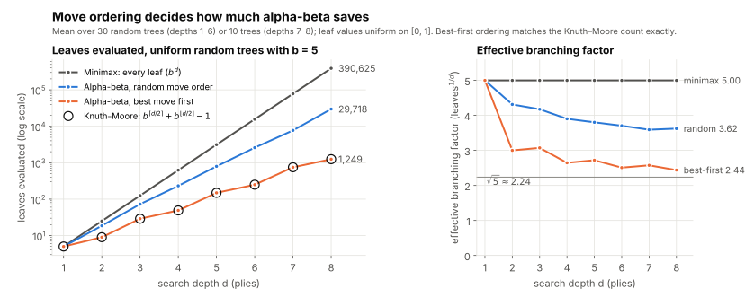
<table header-row="true">
<tr>
<td>Depth d</td>
<td>Minimax: $`5^d`$</td>
<td>Alpha–beta, random order (mean)</td>
<td>Alpha–beta, best move first</td>
<td>Knuth–Moore formula</td>
</tr>
<tr>
<td>2</td>
<td>25</td>
<td>18.6</td>
<td>9</td>
<td>9</td>
</tr>
<tr>
<td>3</td>
<td>125</td>
<td>72.8</td>
<td>29</td>
<td>29</td>
</tr>
<tr>
<td>4</td>
<td>625</td>
<td>231.8</td>
<td>49</td>
<td>49</td>
</tr>
<tr>
<td>5</td>
<td>3,125</td>
<td>795.0</td>
<td>149</td>
<td>149</td>
</tr>
<tr>
<td>6</td>
<td>15,625</td>
<td>2,588.0</td>
<td>249</td>
<td>249</td>
</tr>
<tr>
<td>7</td>
<td>78,125</td>
<td>7,712.0</td>
<td>749</td>
<td>749</td>
</tr>
<tr>
<td>8</td>
<td>390,625</td>
<td>29,718.3</td>
<td>1,249</td>
<td>1,249</td>
</tr>
</table>
Worst-first ordering pruned almost nothing (at depth 8 it still read 281,515 of the 390,625 leaves).
<callout icon="⭐" color="yellow_bg">
	**With perfect move ordering**, alpha–beta on a uniform tree of branching factor $`b`$ and depth $`d`$ reads exactly
	$$
	b^{\lceil d/2 \rceil} + b^{\lfloor d/2 \rfloor} - 1 \;\approx\; 2\, b^{d/2}
	$$
	leaves (Knuth and Moore, 1975), against $`b^d`$ for minimax. The effective branching factor drops from $`b`$ to $`\sqrt{b}`$, so **in the same time alpha–beta searches about twice as deep**. With random ordering the count is roughly $`b^{3d/4}`$; with the worst ordering, no better than minimax. The experiment above matches the formula exactly at every depth.
</callout>
<callout icon="🧮" color="gray_bg">
	**What "twice as deep" means for chess.** Chess has about $`b = 35`$ legal moves per position. Suppose a program can evaluate $`10^9`$ positions per move.
	- Minimax: $`35^d \le 10^9`$ gives $`d \le 5.8`$, so **5 plies** (half-moves).
	- Alpha–beta, random order ($`35^{3d/4}`$): about **7–8 plies**.
	- Alpha–beta, perfect order: $`35^5 + 35^5 - 1 \approx 10^8`$ at $`d = 10`$, so **10 plies**, with 11 just out of reach.
	Searching 10 plies instead of 5 is the difference between a beginner and a strong player.
</callout>
<callout icon="➕" color="gray_bg">
	**How real programs get a good move order** (beyond the slides; this is part of what Schalk's Chapter 4 and the Chess Programming Wiki discuss under *move reordering*, Lecture 7 slide 41):
	- **Iterative deepening:** search to depth 1, then 2, then 3, and so on, each time trying first the best move found by the previous, shallower search. The repeated work is small (the last level dominates), and the program always has an answer ready when time runs out.
	- **Transposition table:** a hash table of positions already searched (the same position is often reached by different move orders), storing their value, the depth searched and the best move, which is tried first next time.
	- **Killer moves:** a move that caused a cut-off in a sibling position at the same depth is likely to cause one here too, so try it early.
	- **History heuristic:** keep a score for each move that caused cut-offs anywhere in the search, and order moves by score.
	- **Game knowledge:** in chess, try captures first, especially a cheap piece taking a valuable one, then checks.
</callout>
## B10 · When the tree is still too big: depth limit and evaluation function
Lecture 6 · slides 17–19 · handout p. 6 {color="gray"}
Alpha–beta needs the tree to be small enough to generate down to the final positions. For many interesting games it is not (slide 17). The solution is a **limited-depth search with an evaluation function**:
1. Search only to a fixed depth $`d`$.
2. At depth $`d`$, apply a **heuristic evaluation function** to the position.
3. Treat that heuristic value **as if it were the true value**, and back it up with minimax or alpha–beta as usual.
4. The result is an **approximate** solution.
<callout icon="📘" color="blue_bg">
	**Evaluation function** (slide 18). A function that assigns a numerical score to a position **without searching further**, estimating how good the position is. Requirements: it gives a decent approximation; it lets positions be compared; a higher value means the position is easier to win; and it is **fast** to compute, because it is called at every frontier node. *"An evaluation function is guessing the true value, and it's the programmer's job to make it the most educated guess possible."*
</callout>
With $`e(J)`$ for the evaluation function, the value the program actually computes is the **depth-limited minimax value**:
$$
V_d(J)=\begin{cases}
U(J) & \text{if } J \text{ is a final position (the true pay-off)}\\
e(J) & \text{if } J \text{ is at the depth limit } d \text{ (a guess)}\\
\max_j V_d(J_j) & \text{if MAX moves at } J\\
\min_j V_d(J_j) & \text{if MIN moves at } J
\end{cases}
$$

<callout icon="⚠️" color="red_bg">
	**Critical dependency** (slide 17): the quality of the result depends heavily on the quality of the evaluation function. Good heuristic, strong play; poor heuristic, weak play. And alpha–beta does not care that the numbers at the frontier are guesses: it backs them up as if they were exact.
</callout>
<callout icon="⭐" color="yellow_bg">
	**The core approach** (slide 19). All successful game-playing programs use (1) alpha–beta search to a limited depth, (2) an evaluation function at the depth limit, and (3) treat the heuristic value as if it were the true value. Instead of searching to the end of the game, they search to a fixed depth and estimate the value of positions using knowledge of the game. This underlies every commercial chess program and most other game AIs.
</callout>
<callout icon="💡" color="purple_bg">
	**Why searching ahead helps even with an imperfect guess.** The evaluation function is consulted only at the frontier, several moves away. Everything between the root and the frontier is computed exactly by minimax, so short-term tactics (a piece that can be captured, a threat that must be blocked) are seen by the search even if the evaluation function knows nothing about them. The deeper the search, the less the guesses matter.
</callout>
<callout icon="➕" color="gray_bg">
	**The horizon effect** (beyond the slides; covered in Schalk's Chapter 4 and on the Chess Programming Wiki). A fixed depth limit can stop the search in the middle of something. Example: the last move inside the horizon is your queen capturing a pawn; the evaluation function sees you a pawn up, but the opponent's recapture of your queen is one move beyond the horizon. Programs fix this with **quiescence search**: at the frontier, keep searching "noisy" moves (captures, checks) until the position is quiet, and only then evaluate.
</callout>
The handout ends Lecture 6 with two remarks worth keeping. In a two-person zero-sum game, alpha–beta (run to the end of the game) finds equilibrium strategies and the equilibrium pay-off, exactly like minimax; in particular, **if one player has a winning strategy, alpha–beta finds it**. And it can be applied for each player of a general-sum game, finding values and strategies that guarantee at least those values.
## B11 · Lecture 6 in brief
<table header-row="true">
<tr>
<td>Idea</td>
<td>In one line</td>
</tr>
<tr>
<td>Key insight</td>
<td>Values found so far bound what other sub-games can contribute; stop exploring a sub-game once it cannot change the decision.</td>
</tr>
<tr>
<td>α and β</td>
<td>The best MAX and MIN can already guarantee on the current path; start at $`-\infty`$ and $`+\infty`$; α changes only at MAX nodes, β only at MIN nodes.</td>
</tr>
<tr>
<td>Cut-off</td>
<td>At a MAX node when $`v \ge \beta`$; at a MIN node when $`v \le \alpha`$; equivalently, when $`\beta \le \alpha`$.</td>
</tr>
<tr>
<td>Correctness</td>
<td>The root value is exactly the minimax value; values of cut nodes are only bounds.</td>
</tr>
<tr>
<td>Move ordering</td>
<td>Best move first: about $`b^{d/2}`$ leaves, twice the depth; random: about $`b^{3d/4}`$; worst: about $`b^d`$.</td>
</tr>
<tr>
<td>Large games</td>
<td>Alpha–beta to depth $`d`$, an evaluation function at the frontier, treated as the true value.</td>
</tr>
</table>
<details>
<summary>Check yourself: at a MIN node with window (3, 9), the children return 12, 7 and 2 in that order. What does the node do after each, and what does it return?</summary>
	12: $`12 \ge \beta = 9`$ at a MIN node, so ignore it. 7: $`3 < 7 < 9`$, so set β = 7. 2: $`2 \le \alpha = 3`$, so cut-off: return 2 (meaning "at most 2", which the MAX node above will ignore because it already has 3).
</details>
<details>
<summary>Check yourself: why can a MAX node never cause a cut-off by lowering β?</summary>
	A MAX node never changes β at all: β is the best MIN can already guarantee, and only a MIN node's choices can improve that. A MAX node can only raise α, and it cuts off when the value it has found reaches the β it was given.
</details>
<details>
<summary>Check yourself: with b = 10 and d = 6, how many leaves does minimax read, and how many does alpha–beta read with perfect ordering?</summary>
	Minimax: $`10^6 = 1{,}000{,}000`$. Alpha–beta with perfect ordering: $`10^3 + 10^3 - 1 = 1{,}999`$, about 500 times fewer.
</details>
# Part C · Lecture 7: Alpha–beta in practice, and evaluation functions
Jonathan Shapiro · 41 slides {color="gray"}
## C1 · Where Lecture 7 starts
Lecture 7 · slides 1–5 {color="gray"}
- **Slide 2:** attendance is taken on SEAtS.
- **Slide 3, announcements:** reading for today, Schalk **Chapter 3** (minimax and alpha–beta: Parts A and B here); reading for this week, **Chapter 4** (game-playing programs: this Part); the next two weeks are on **learning in games**.
- **Slide 4:** the online Q&A session, called "Example class" in the timetable, is on Monday 19 October 2026 at 2 pm on Zoom (the link is on the slide).
- **Slide 5, last time:** (1) for zero-sum games with perfect information we can find the minimax solution on trees that are not too big; (2) we need not evaluate all nodes: alpha–beta prunes those that cannot give any information. Today: (3) make sure alpha–beta is understood, by working examples; (4) what to do when the tree is too large to search to the terminal nodes.
## C2 · Shapiro's version of the rules, and his evaluate function
Lecture 7 · slides 6–7 {color="gray"}
Slide 6 restates alpha–beta in one paragraph: pass the current range $`[\alpha, \beta]`$ down the tree; when passed down the range is unchanged, but a child can change the range of its parent; only MAX nodes change α and only MIN nodes change β; each node holds a range in which **α is the maximum lower bound** on its value and **β the minimum upper bound**; **when β ≤ α, prune** the subtree containing that node; start with $`[-\infty, \infty]`$. This is exactly B3–B4 in other words: the six-cell table collapses to the single test $`\beta \le \alpha`$ after each update.
Slide 7 writes it as a function `evaluate(node J, α, β)` that returns a value and a pointer to the chosen child. Line by line:
<table header-row="true">
<tr>
<td>Line</td>
<td>Slide 7 says</td>
<td>What it means</td>
</tr>
<tr>
<td>1</td>
<td>If J is a terminal node, return U(J) and a pointer to null.</td>
<td>A final position: return its pay-off $`U(J)`$; there is no move to recommend.</td>
</tr>
<tr>
<td>2.1</td>
<td>(MAX node) Get next unvisited child of J → n_i.</td>
<td>Generate the children one at a time.</td>
</tr>
<tr>
<td>2.2</td>
<td>If i = 1, α = J(n_i), else α = max\[α, evaluate(n_i, α, β)\].</td>
<td>$`J(n_i)`$ means the value returned by `evaluate(n_i, α, β)`. The first child's value becomes the node's α; each later child can only raise it.</td>
</tr>
<tr>
<td>2.3</td>
<td>If β ≤ α, break.</td>
<td>The cut-off: MIN above will never allow this node.</td>
</tr>
<tr>
<td>2.4</td>
<td>Until all child nodes of J are evaluated. Return α and pointer to a child with value α.</td>
<td>Loop back to 2.1; at the end report α and the best move.</td>
</tr>
<tr>
<td>3.1–3.4</td>
<td>The same for a MIN node, with β = min\[β, evaluate(n_i, α, β)\].</td>
<td>The mirror image: the first child sets β, later ones can only lower it; break if β ≤ α; return β and the move.</td>
</tr>
</table>
<callout icon="⚠️" color="red_bg">
	**A detail in line 2.2.** Read literally, the first child *replaces* the α the node inherited, instead of taking $`\max(\alpha, \cdot)`$ as in Lecture 6's table. The result is still always correct: the replacement can only make the window *wider*, which may prune a little less, never wrongly. On every tree in this week's slides, the literal slide-7 version and the Lecture 6 version read **exactly the same leaves** (checked by running both). In an exam use Lecture 6's table, $`\alpha \leftarrow \max(\alpha, v)`$, for every child; it is the standard algorithm.
</callout>
## C3 · Worked example 1
Lecture 7 · slide 8 {color="gray"}
Squares are MAX nodes and circles MIN nodes. The root (MAX) has three MIN children:
- **C1**: a leaf 2, and node **2.1** (MAX), which has a leaf 3 and node **3.1** (MIN) with a single leaf −3.
- **C2**: a leaf −3, and node **2.2** (MAX) with a single leaf 3.
- **C3**: a leaf 3, and node **2.3** (MAX) with a single leaf 4.
<callout icon="🎯" color="green_bg">
	**Try it yourself first.** Copy the tree from slide 8, write the window next to each node as you enter it, and mark each cut. Then compare with the table and Figure C1.
</callout>
<table header-row="true">
<tr>
<td>Step</td>
<td>Node and window on entry</td>
<td>Event</td>
<td>Action</td>
</tr>
<tr>
<td>1</td>
<td>C1 $`(-\infty, \infty)`$</td>
<td>leaf 2</td>
<td>β = 2</td>
</tr>
<tr>
<td>2</td>
<td>2.1 $`(-\infty, 2]`$</td>
<td>leaf 3</td>
<td>$`3 \ge \beta = 2`$ at MAX: **cut-off**. Node 3.1 and its leaf −3 are never visited. 2.1 returns 3 (meaning "at least 3").</td>
</tr>
<tr>
<td>3</td>
<td>C1</td>
<td>2.1 returned 3</td>
<td>$`3 \ge \beta`$ at MIN: ignore. **C1 = 2**. Root: α = 2.</td>
</tr>
<tr>
<td>4</td>
<td>C2 $`[2, \infty)`$</td>
<td>leaf −3</td>
<td>$`-3 \le \alpha = 2`$ at MIN: **cut-off**. Node 2.2 and its leaf 3 are never visited. C2 returns −3 ("at most −3"); the root ignores it.</td>
</tr>
<tr>
<td>5</td>
<td>C3 $`[2, \infty)`$</td>
<td>leaf 3</td>
<td>$`2 < 3 < \infty`$: β = 3, window $`[2, 3]`$.</td>
</tr>
<tr>
<td>6</td>
<td>2.3 $`[2, 3]`$</td>
<td>leaf 4</td>
<td>$`4 \ge \beta = 3`$: cut-off (2.3 has no other children anyway). Returns 4.</td>
</tr>
<tr>
<td>7</td>
<td>C3</td>
<td>2.3 returned 4</td>
<td>Ignore. **C3 = 3**.</td>
</tr>
<tr>
<td>8</td>
<td>Root</td>
<td>C3 returned 3</td>
<td>$`3 > \alpha = 2`$: α = 3. **Value 3; best move C3.**</td>
</tr>
</table>
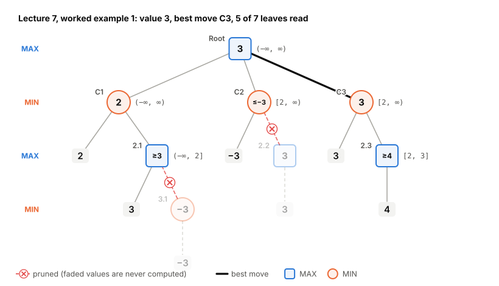
Check with plain minimax: 3.1 = −3, 2.1 = max(3, −3) = 3, C1 = min(2, 3) = 2; 2.2 = 3, C2 = min(−3, 3) = −3; 2.3 = 4, C3 = min(3, 4) = 3; root = max(2, −3, 3) = **3**. Same answer, but alpha–beta never needed to know 3.1 or 2.2.
## C4 · Worked example 2
Lecture 7 · slide 9 {color="gray"}
A deeper tree. The root (MAX) has three MIN children:
- **C1**: a leaf −3, and node **2.1** (MAX) with a leaf 4 and node **3.1** (MIN). Node 3.1 has two MAX children: **4.1** with leaves −13, 10 and **4.2** with leaves 12, −12.
- **C2**: a single child **2.2** (MAX), whose single child **3.2** (MIN) has leaves −13, −10.
- **C3**: a leaf 4, and node **2.3** (MAX) with a leaf 5 and node **3.3** (MIN). Node 3.3 has two MAX children: **4.3** with leaves −4, −3 and **4.4** with leaves 6, 5.
<table header-row="true">
<tr>
<td>Step</td>
<td>Node and window on entry</td>
<td>Event</td>
<td>Action</td>
</tr>
<tr>
<td>1</td>
<td>C1 $`(-\infty, \infty)`$</td>
<td>leaf −3</td>
<td>β = −3</td>
</tr>
<tr>
<td>2</td>
<td>2.1 $`(-\infty, -3]`$</td>
<td>leaf 4</td>
<td>$`4 \ge \beta = -3`$: **cut-off**. The whole of 3.1 (4.1, 4.2 and four leaves) is never visited. Returns 4.</td>
</tr>
<tr>
<td>3</td>
<td>C1</td>
<td>2.1 returned 4</td>
<td>Ignore. **C1 = −3**. Root: α = −3.</td>
</tr>
<tr>
<td>4</td>
<td>C2 $`[-3, \infty)`$, then 2.2 and 3.2 with the same window</td>
<td>3.2's first leaf −13</td>
<td>$`-13 \le \alpha = -3`$ at MIN: **cut-off**; the leaf −10 is never read. 3.2 returns −13.</td>
</tr>
<tr>
<td>5</td>
<td>2.2</td>
<td>3.2 returned −13</td>
<td>$`-13 \le \alpha`$ at MAX: ignore. No more children: 2.2 returns its α, −3 (meaning "at most −3"; its true value is −13).</td>
</tr>
<tr>
<td>6</td>
<td>C2</td>
<td>2.2 returned −3</td>
<td>$`-3 \le \alpha = -3`$ at MIN: **cut-off** (an equality cut). The root ignores C2.</td>
</tr>
<tr>
<td>7</td>
<td>C3 $`[-3, \infty)`$</td>
<td>leaf 4</td>
<td>β = 4: window $`[-3, 4]`$.</td>
</tr>
<tr>
<td>8</td>
<td>2.3 $`[-3, 4]`$</td>
<td>leaf 5</td>
<td>$`5 \ge \beta = 4`$: **cut-off**. The whole of 3.3 (4.3, 4.4 and four leaves) is never visited. Returns 5.</td>
</tr>
<tr>
<td>9</td>
<td>C3, then the root</td>
<td>2.3 returned 5</td>
<td>Ignore: **C3 = 4**. Root: $`4 > -3`$, α = 4. **Value 4; best move C3.**</td>
</tr>
</table>
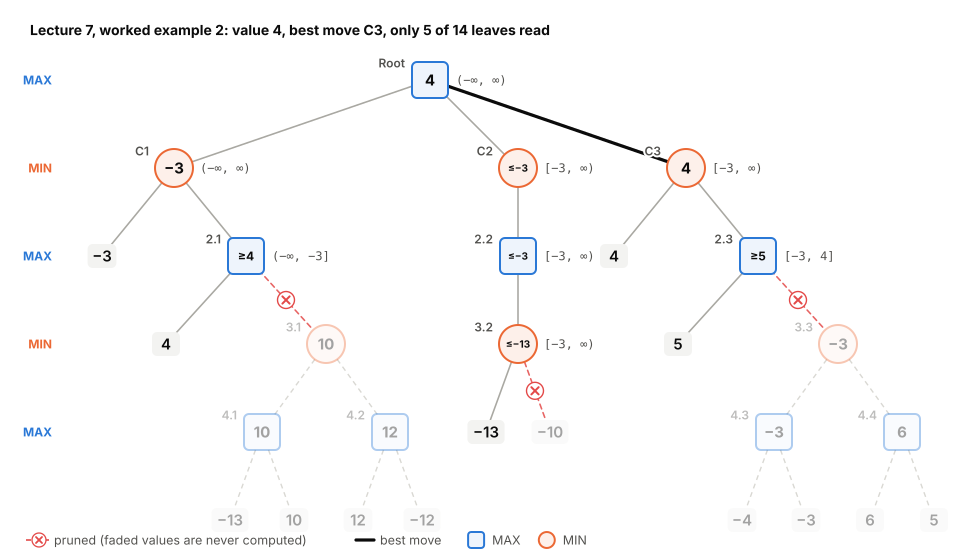
<table header-row="true">
<tr>
<td>Node</td>
<td>True minimax value</td>
<td>What alpha–beta learned</td>
</tr>
<tr>
<td>4.1, 4.2, 3.1</td>
<td>10, 12, 10</td>
<td>nothing (pruned)</td>
</tr>
<tr>
<td>2.1</td>
<td>max(4, 10) = 10</td>
<td>at least 4: enough, since C1 already had −3</td>
</tr>
<tr>
<td>C1</td>
<td>−3</td>
<td>−3 (exact)</td>
</tr>
<tr>
<td>3.2, 2.2, C2</td>
<td>−13, −13, −13</td>
<td>at most −13, at most −3, at most −3</td>
</tr>
<tr>
<td>4.3, 4.4, 3.3</td>
<td>−3, 6, −3</td>
<td>nothing (pruned)</td>
</tr>
<tr>
<td>2.3</td>
<td>max(5, −3) = 5</td>
<td>at least 5: enough, since C3 already had 4</td>
</tr>
<tr>
<td>C3, root</td>
<td>4, 4</td>
<td>4, 4 (exact)</td>
</tr>
</table>
Look at 2.1: its true value is 10, but alpha–beta only ever knew "at least 4". That was enough, because C1 already had a leaf worth −3 and MIN would never let MAX into a node worth more.
<callout icon="💡" color="purple_bg">
	**The order made this example easy.** Each MIN node's first leaf was its best move for MIN, so each MAX child could be cut after one leaf. Search the same tree *right to left* and alpha–beta reads **13 of the 14 leaves** (checked by program). Same tree, same answer, more than twice the work: move ordering again.
</callout>
<callout icon="🎯" color="green_bg">
	**Setting out an alpha–beta answer.** (1) Write the window $`[\alpha, \beta]`$ beside each node *as you enter it*; (2) beside each node write its value, or a bound such as "≥ 4" if it was cut; (3) mark every pruned edge clearly and say which nodes or leaves are never visited; (4) state the root value and the best move. Say which rule caused each cut (for example "4 ≥ β = −3 at a MAX node"). Do not forget equality cuts.
</callout>
## C5 · Large games: search to a depth, then guess
Lecture 7 · slides 10–13 {color="gray"}
Often the game tree is so large that minimax cannot reach terminal nodes at all, except towards the end of the game (slide 10). Then (slides 11–12) introduce an **evaluation function** (also called a board evaluation function, heuristic evaluation function, or just a *heuristic*): an approximation to the true value $`V(J)`$, used exactly as if it were the value. Search the tree to a given depth or until terminal nodes are found; evaluate each node at the end of the search with $`U`$ if it is terminal or with the evaluation function if it is not; propagate those values up the minimax tree (this is the depth-limited value $`V_d`$ of B10). The sign convention (slide 13): the evaluation function approximates the pay-off reachable from the node, so a **more positive** value means **Player 1 is more likely to win**, a **more negative** value means Player 2 is.
<callout icon="⚠️" color="red_bg">
	**"Unlike in A\*, notions of admissible or monotonic do not apply"** (slide 13). In A\* search (from earlier AI courses), the heuristic $`h(n)`$ estimates the remaining *cost to reach a goal*, and two properties make A\* find optimal paths: **admissible**, $`h`$ never overestimates the true cost, and **monotonic** (consistent), $`h(n) \le c(n, n') + h(n')`$ along every step. A game evaluation function estimates something different, *who is winning*, and there is no "never overestimate" condition that would make the search's answer exact. It is simply a guess, and it can be wrong in either direction.
</callout>
<callout icon="➕" color="gray_bg">
	**Beyond the slides: only the order matters, unless there is chance.** Minimax uses only comparisons (max and min), so replacing $`e`$ by any strictly increasing function of it, such as $`e^3`$ or $`2e + 7`$, gives exactly the same decisions. With chance nodes this breaks, because averages are not preserved. A sure 2 against a fair coin between 0 and 3: expected values 2 and 1.5, so choose the sure 2. Square every value: 4 against $`\tfrac12(0 + 9) = 4.5`$, so now choose the coin. With chance nodes the evaluation's *size* matters, not just its order.
</callout>
## C6 · Tic-tac-toe: counting open lines
Lecture 7 · slides 14–16 {color="gray"}
Slide 14 shows three positions in sequence and asks what a good heuristic would be. Slide 15 gives the classic answer. There are **eight lines** on which a player can get three in a row: 3 rows, 3 columns, 2 diagonals. A line is still *open* for X if it contains no O, and open for O if it contains no X.
$$
h(J) = (\text{number of lines where X can still win}) - (\text{number of lines where O can still win})
$$
Player 1 (X) wants to maximise $`h`$ and Player 2 (O) to minimise it.
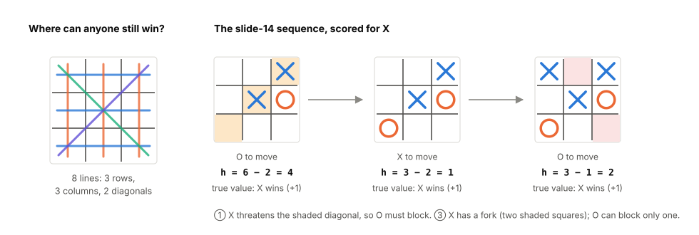
<callout icon="🧮" color="gray_bg">
	**Scoring slide 14's first position** (X in the top-right corner and the centre, O on the right edge; squares named a b c / d e f / g h i, so X on c and e, O on f).
	- Open for X (no O): rows abc ✓, def ✗ (O on f), ghi ✓; columns adg ✓, beh ✓, cfi ✗; diagonals aei ✓, ceg ✓. **6 lines.**
	- Open for O (no X): abc ✗ (X on c), def ✗ (X on e), ghi ✓, adg ✓, beh ✗, cfi ✗, aei ✗, ceg ✗. **2 lines.**
	- $`h = 6 - 2 = 4`$.
	The second position (O blocks at g) scores $`3 - 2 = 1`$; the third (X takes a) scores $`3 - 1 = 2`$.
</callout>
The sequence on slide 14 is instructive because **X can force a win in all three positions**: in the first X threatens the c–e–g diagonal, so O *must* block at g; then X plays a and threatens both a–b–c and a–e–i at once (a *fork*), and O can block only one. The heuristic scores these positions 4, 1 and 2, nowhere near "certain win": it counts possibilities but not threats. That is fine, because the search corrects it: a search of just two or three moves from any of these positions finds the forced win.
<callout icon="➕" color="gray_bg">
	**A sharper heuristic (beyond the slides).** Weight lines by how many marks they already hold: with $`X_n`$ the number of lines containing $`n`$ X's and no O, and $`O_n`$ likewise,
	$$
	e(J) = 3X_2 + X_1 - (3O_2 + O_1),
	$$
	and give a completed line $`\pm\infty`$ (or the largest possible value). On the three positions it gives 6, 1 and 6: it now sees the two-in-a-row threats of the first and the fork of the third. This is the usual textbook evaluation for tic-tac-toe.
</callout>
**Slide 16: search depth 2.** X to move on the empty board searches two plies (its own move and O's reply) and evaluates each resulting position with $`h`$. By symmetry X has only three different first moves (corner, edge, centre) and each has only a few different replies.
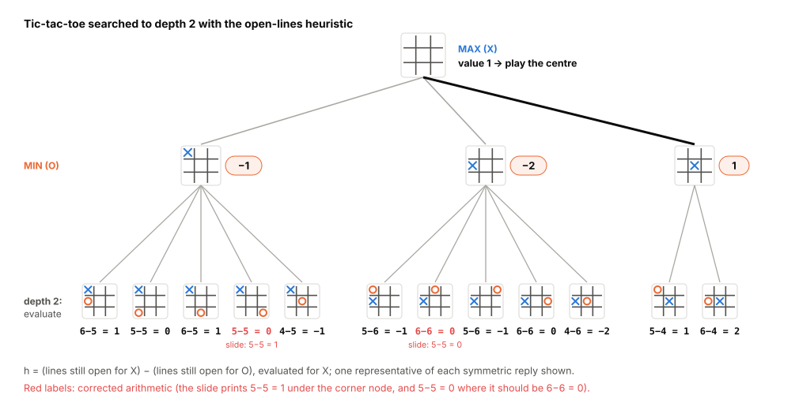
- **X in a corner:** O's five essentially different replies score 1, 0, 1, 0 and −1. MIN takes the smallest: **−1** (O in the centre).
- **X on an edge:** replies score −1, 0, −1, 0, −2. MIN: **−2** (O in the centre).
- **X in the centre:** O in a corner scores 1, O on an edge 2. MIN: **1**.
- MAX: $`\max(-1, -2, 1) = 1`$: **X opens in the centre**, the move most players would choose. (With perfect play every opening move only draws; the true value of tic-tac-toe is 0. The heuristic and a shallow search simply pick the move that keeps the most options open.)
<callout icon="⚠️" color="red_bg">
	**Errors in the slide-16 figure.** Under the corner node, the fourth label reads "5−5=1"; it should be **5−5=0** (X in a corner, O in the opposite corner). Under the edge node, the second label reads "5−5=0"; the value 0 is right but the counts are **6−6=0** (with X on an edge, O always has 6 open lines). The red labels in Figure C4 are the corrected ones. The figure's source link is broken, as the slide itself notes, so there is nothing to look up.
</callout>
## C7 · Connect-4: unblocked lines and distance to a win
Lecture 7 · slides 17–19 {color="gray"}
Connect-4: two players drop discs into a 7-column, 6-row vertical board, each disc falling to the lowest empty cell of its column; four in a row (horizontally, vertically or diagonally) wins. Slides 18–19 give two heuristics.
1. **Unblocked lines:** (number of unblocked rows, columns and diagonals for Player 1) − (the same for Player 2). A *line* here is any window of four cells in a row, and it is unblocked for a player if the opponent has no disc in it. The same idea as tic-tac-toe's open lines.
2. **Distance to the nearest win:** (distance to the nearest win for Player 2) − (distance to the nearest win for Player 1), where a player's distance is how many more discs it needs to complete some unblocked line. Positive when Player 1 is closer to winning than Player 2.
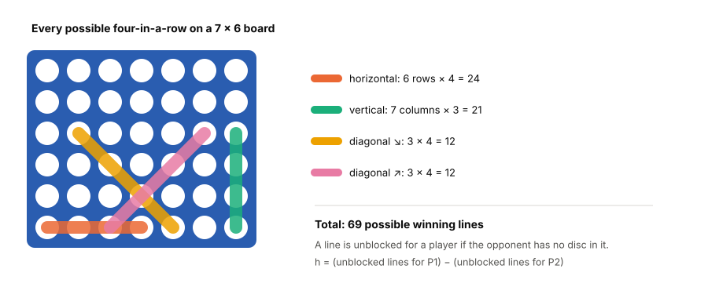
<callout icon="⚠️" color="red_bg">
	**Typo on slides 18–19.** The first heuristic reads "…for Player 1 minus number of unblocked rows, columns, diagonals for **Player 1**". The second "Player 1" should be **Player 2**: as written, the heuristic is always zero.
</callout>
<callout icon="➕" color="gray_bg">
	**Beyond the slides.** Heuristic 2 can be sharpened by taking gravity into account: a line one disc from completion is only an immediate threat if its empty cell can be played now (the cell below it is filled). Connect-4 itself was solved in 1988, independently by James Allen and Victor Allis: the first player can force a win by starting in the centre column.
</callout>
## C8 · Othello (Reversi): four features
Lecture 7 · slides 20–25 {color="gray"}
Othello is played on an 8 × 8 board. A move places a disc of your colour so that one or more straight lines of opponent discs (in any of 8 directions) are **flanked** between the new disc and another of yours; all flanked discs are flipped to your colour. A move must flip at least one disc; if you have no legal move you pass; the player with more discs at the end wins. You can play it at [eothello.com](https://eothello.com/) (slide 20). Slides 21–25 list four ideas for a heuristic, each a **relative difference** between the players, "combined in some way":
1. **Coin parity:** relative difference in the number of discs.
2. **Mobility:** relative difference in the number of legal moves.
3. **Corners:** difference in the number of corners captured.
4. **Stability:** (number of discs that can never be flanked) − (number that can be flanked on the next move), compared between the players.
A natural way to make a difference "relative" is to scale it to lie between −100 and 100:
$$
\text{feature} = 100 \cdot \frac{\text{(Player 1's count)} - \text{(Player 2's count)}}{\text{(Player 1's count)} + \text{(Player 2's count)}}
$$
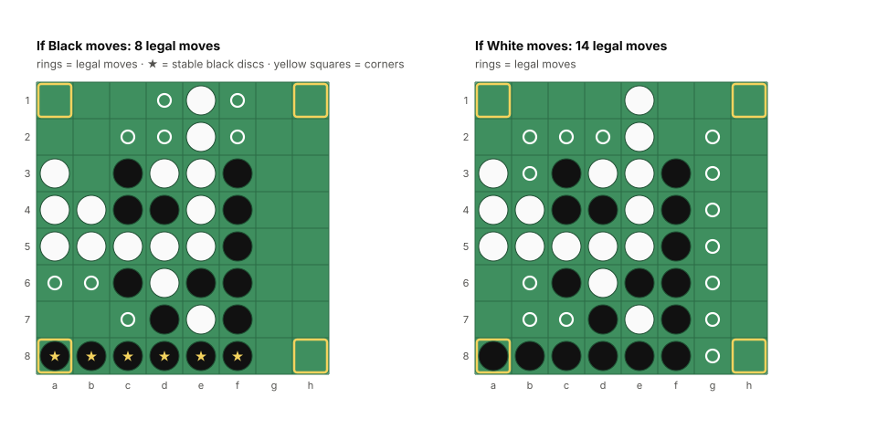
<table header-row="true">
<tr>
<td>Feature</td>
<td>Black</td>
<td>White</td>
<td>From Black's point of view</td>
</tr>
<tr>
<td>Discs (coin parity)</td>
<td>17</td>
<td>15</td>
<td>$`100 \cdot \tfrac{2}{32} = +6.25`$</td>
</tr>
<tr>
<td>Legal moves (mobility)</td>
<td>8</td>
<td>14</td>
<td>$`100 \cdot \tfrac{-6}{22} \approx -27.3`$</td>
</tr>
<tr>
<td>Corners</td>
<td>1 (a8)</td>
<td>0</td>
<td>$`+100`$</td>
</tr>
<tr>
<td>Stability: stable discs − discs flippable next move</td>
<td>6 − 11 = −5</td>
<td>0 − 8 = −8</td>
<td>Black better by 3</td>
</tr>
</table>
(All counts computed by a move generator on the slide's position; whose turn it is does not matter for these counts.) The features **disagree**: by disc count Black is barely ahead; by mobility White is well ahead (14 options against 8); by corners and stability Black is ahead. That is why they must be "combined in some way", and why the combination matters.
<callout icon="💡" color="purple_bg">
	**Why these features.** A **corner** disc can never be flanked (there is no square beyond it), so it can never be flipped, and it anchors the edge discs next to it: that is why Black's whole bottom row is permanently Black. **Mobility** matters because a player with few legal moves can be forced into bad ones; strong players try to limit the opponent's options, and holding many discs in mid-game often *reduces* your own options. **Coin parity** is what decides the game at the very end, so its weight should grow as the board fills (beyond the slides: real programs use different weights in the opening, middle game and endgame).
</callout>
## C9 · Checkers (draughts)
Lecture 7 · slides 26–28 {color="gray"}
Checkers is played on the dark squares of an 8 × 8 board. Ordinary pieces (*men*) move diagonally forward one square and capture by jumping over an adjacent opponent piece; a man that reaches the far row becomes a **king**, which can move and capture backwards too. Slide 26 points to a public program, [Hsankesara/Draughts-AI](https://github.com/Hsankesara/Draughts-AI), which is built exactly as this week describes: a depth-limited minimax agent, then alpha–beta pruning, then improved evaluation functions. Its heuristics are the ones on slides 27–28:
**Middle game** (slide 27):
- **How many pieces?** (number of men + 2 × number of kings) − the same for the opponent. A king is worth about two men.
- **How many have reached the opponent's half?** (5 × pieces on your own half + 7 × pieces on the opponent's half) − the same for the opponent. Every piece counts, but advanced pieces count more.
- **How far ahead are your pieces?** (sum of the rows advanced by all your pieces) − the same for the opponent.
**Endgame** (slide 28), when few pieces remain and most are kings: use the **distance between your kings and the opponent's kings**. **Maximise** it if you have *fewer* kings than the opponent (defence: run away and hope for a draw); **minimise** it if you have *more* (offence: hunt the opponent down, since a win requires capturing everything).
<callout icon="🧮" color="gray_bg">
	**A quick check of the second midgame heuristic.** You have 7 men, 4 on your half and 3 on the opponent's; the opponent has 7 men, 5 on its own half and 2 on yours. You score $`5 \cdot 4 + 7 \cdot 3 = 41`$, the opponent $`5 \cdot 5 + 7 \cdot 2 = 39`$, so the heuristic is $`41 - 39 = +2`$: equal material, but your pieces are further forward.
</callout>
## C10 · Chinese checkers
Lecture 7 · slide 29 {color="gray"}
Chinese checkers is played on a star-shaped board; each player must move all their pieces from their own corner to the opposite one. A move is either a step to an adjacent hole or a chain of jumps over pieces (one's own or the opponent's), which can carry a piece a long way. Slide 29 shows the restricted two-player board and gives a simple heuristic: the **board distance of a move**, that is, end position minus start position measured towards the goal corner: prefer moves that carry a piece furthest forward. Applied to whole positions (beyond the slides), the same idea gives "total remaining distance of the opponent's pieces minus total remaining distance of mine", which is the same kind of race measure as backgammon's $`e_1`$ in C12.
## C11 · How to find good heuristics
Lecture 7 · slide 30 {color="gray"}
Finding a good heuristic is often a hard problem, and it requires knowledge of the game. Slide 30 adds two practical rules.
**Normalise against the terminal values.** The search compares heuristic guesses at the frontier with true pay-offs at terminal nodes, so they must be on the same scale.
<callout icon="⚠️" color="red_bg">
	**What goes wrong without normalisation.** Suppose a win is worth +1, but the heuristic can return values up to +5. A position the heuristic happens to score +3 now looks *better than an actual forced win*, and the program will happily walk away from a win. Keep $`e(J)`$ strictly between the loss and win values (Figure B5 does this: guesses lie in $`(-1, 1)`$, the win is +1), or give wins and losses values larger than any heuristic can produce.
</callout>
**Use trial and error, by playing.** Given two heuristics, play them **against each other** in many games, **from both starting positions** (each takes a turn as the first player, since moving first is often an advantage), and play both against **other heuristics** too. The one that wins most is likely better. "Likely", because game results are noisy and "A beats B" is not always transitive: A can beat B, B beat C, and C beat A, as in rock–paper–scissors.
## C12 · Combining heuristics: backgammon
Lecture 7 · slides 31–32 {color="gray"}
One feature is rarely enough. Slide 31's example is **backgammon**: a race game with dice in which each player moves 15 pieces around the board towards home and then *bears them off*; a lone piece on a point (a *blot*) can be hit by the opponent and sent back to the start. Two natural heuristics pull in opposite directions:
- **Make aggressive progress:** $`e_1`$ = (the distance the opponent still needs to remove all its pieces from the board) − (the distance you still need). Positive when you are ahead in the race.
- **Protect your pieces:** $`e_2`$ = − (the number of your vulnerable pieces).
You need a balance: too much weight on $`e_1`$ is too aggressive (it races ahead and leaves blots to be hit); too much on $`e_2`$ is too conservative (it never takes a risk). With $`k`$ heuristics $`e_1(J), \dots, e_k(J)`$ the standard way to combine them (slide 32) is a **linear combination**
$$
H(J) = w_1 e_1(J) + w_2 e_2(J) + \dots + w_k e_k(J),
$$
and the question becomes: **how do we find the best, or at least a good, set of weights?** The rest of the lecture gives three methods.
## C13 · Methods I and II: hand-tweaking and the stochastic hill climber
Lecture 7 · slides 33–35 {color="gray"}
**Method I, hand-tweaking** (slide 33): set the weights by guesswork and adjust them by hand after watching the program play. Often what is actually done.
**Method II, stochastic hill climbing** (slide 34): start with some weights (random, or a sensible guess), then repeat: (1) perturb the weights slightly using a random number generator; (2) compare the heuristic with the original weights against the one with the perturbed weights by playing them against each other in one or more games; (3) keep the better of the two. To decide which heuristic is better, play them against each other $`N`$ times and average the pay-offs. Slide 35 writes it out:
```plain text
Input:  heuristics e1(J), ..., ek(J); a small step size ε
Output: weights (w1, ..., wk)
 3  initialise the weights (randomly, or using knowledge of the game)
 4  normalise the weights to sum to 1                        {optional}
 5  H := Σ wi·ei
 6  while time is left:
 7      generate k zero-mean random numbers r1, ..., rk
 8      ri := ri − (1/k)·Σj rj  for all i                     {optional}
 9      H_test := Σ (wi + ε·ri)·ei
10      if H_test evaluates higher than H:
11          H := H_test
```
Line by line:
- **Line 4, normalising.** Multiplying every weight by the same positive number multiplies $`H`$ by that number, which changes no decision (minimax only compares values, C5). So only the *direction* of the weight vector matters, and fixing $`\sum w_i = 1`$ removes the redundant degree of freedom.
- **Line 7, zero-mean noise.** For example $`r_i`$ drawn from a normal distribution with mean 0: each weight is nudged up or down at random, with no bias.
- **Line 8, removing the mean.** After subtracting the average, $`\sum_i r_i = 0`$ exactly, so the perturbed weights $`w_i + \varepsilon r_i`$ still sum to 1: the step stays on the normalised set.
- **Line 9, the step size ε.** Too large, and the search jumps about without settling; too small, and the difference between $`H`$ and $`H_{test}`$ is too tiny to show up through the noise of game results.
- **Line 10, "evaluates higher".** Means: $`H_{test}`$ wins a match of $`N`$ games against $`H`$ (playing both colours). This is the expensive step.
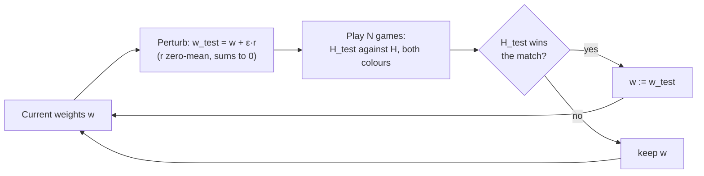
To see how the method behaves, I ran it on an illustrative problem with two heuristics (so one free weight $`w`$ on $`e_1`$ and $`1 - w`$ on $`e_2`$), where the win rate as a function of $`w`$ has a big peak at $`w \approx 0.62`$ and a small bump at $`w \approx 0.18`$, and each comparison is a noisy 40-game match:
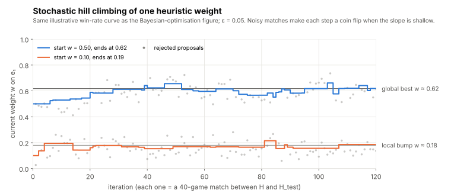
<callout icon="💡" color="purple_bg">
	**What the figure shows about hill climbing.** (1) It works, slowly: tens of matches, each of many games, to move a single weight. (2) It is **noisy**: where the curve is flat, a 40-game match is almost a coin flip, so the weight drifts at random. (3) It gets **stuck in local optima**: from 0.10 every small step away from the bump at 0.18 looks worse, so it never finds the much better weights near 0.62. The usual remedies are restarts from several starting points and larger steps early on.
</callout>
## C14 · Black-box, expensive optimisation
Lecture 7 · slide 36 {color="gray"}
Tuning heuristic weights is an example of **black-box optimisation**. To evaluate a heuristic you must play it in games; the game is like a black box: there is no formula for "win rate as a function of the weights" that you could differentiate or solve. It is also an example of **expensive optimisation**: each evaluation (a match of many games) has a high computational cost, and the result is noisy. Methods that need few evaluations are therefore valuable, which motivates the third method.
## C15 · Method III: Bayesian optimisation
Lecture 7 · slides 37–38 {color="gray"}
**Bayesian optimisation** builds a cheap **surrogate model** of the hidden black-box function from the evaluations made so far, and uses the model to decide where to evaluate next. The model is a **Gaussian process** (GP), a machine-learning model that represents a *probability distribution over functions*. After a few observations it gives, for every candidate input:
- a **posterior mean**: its best guess of the function's value there, passing through (or near) the observations;
- a **posterior uncertainty** (standard deviation): small near points already observed, large far from them.
An **acquisition function** then turns mean and uncertainty into a score for "how useful would it be to evaluate here next?". It balances **exploitation** (where the mean is high, good weights are likely) against **exploration** (where the uncertainty is high, something better might be hiding). Two common choices (beyond the slides):
$$
\text{EI}(w) = \mathbb{E}\big[\max\big(f(w) - f_{\text{best}},\, 0\big)\big], \qquad \text{UCB}(w) = \mu(w) + \kappa\, \sigma(w),
$$
where EI is the *expected improvement* over the best value found so far, and UCB, the *upper confidence bound*, adds $`\kappa`$ standard deviations to the mean. The loop is: fit the GP to all observations; find the input that maximises the acquisition function (cheap, since it only uses the model); evaluate the real black box there (expensive: play the games); add the result to the observations; repeat. Slide 38 shows "the basic picture in 1D": your problem has $`k`$ dimensions, one per weight, but the idea is easiest to see with one.

Reading the run:
- **Iteration 1** (2 observations, at $`w = 0.08`$ and $`0.92`$): the model knows nothing in between; the uncertainty band is wide and the acquisition function is broad. It picks $`w = 0.49`$ (win rate 0.486).
- **Iteration 2** (3 observations): the acquisition function has two humps, either side of the new point; it explores $`w = 0.31`$, which turns out poor (0.376). Exploring sometimes "wastes" an evaluation, but it rules a region out.
- **Iterations 3–4**: it tries $`w = 0.648`$, finding a win rate of 0.698 close to the true best (0.718 at $`w \approx 0.62`$), after only **5 evaluations**, and then refines nearby.
Compare Figure C7, where hill climbing needed dozens of matches to get there, and could miss it altogether. Slide 37's further points:
- Bayesian optimisation is the **default method for hyper-parameter optimisation** in machine learning (choosing learning rates, network sizes and so on is the same kind of expensive black-box problem).
- There are many Python packages, for example **scikit-optimize** (its `gp_minimize` function does exactly this loop). The slide's "PYPI" is the Python Package Index, the place packages are installed from, not a package.
- It **only works on continuous spaces**: the Gaussian process needs a notion of nearby inputs having similar values. Weights are continuous, so heuristic tuning fits well.
<callout icon="📖" color="orange_bg">
	**Look at slide 38's figure** next to Figure C8: it has the same elements (objective function, observations, posterior mean, posterior uncertainty, acquisition function with its maximum, new observation), over three iterations. For the mathematics behind it, the standard introduction is Brochu, Cora and de Freitas, *A Tutorial on Bayesian Optimization of Expensive Cost Functions* (2010), [arXiv:1012.2599](https://arxiv.org/abs/1012.2599); for code, the [scikit-optimize documentation](https://scikit-optimize.github.io/stable/).
</callout>
<table header-row="true">
<tr>
<td></td>
<td>Hand-tweaking</td>
<td>Stochastic hill climbing</td>
<td>Bayesian optimisation</td>
</tr>
<tr>
<td>How it chooses the next weights</td>
<td>Human judgement</td>
<td>A small random step from the current weights</td>
<td>Maximises an acquisition function computed from a model of all results so far</td>
</tr>
<tr>
<td>Uses past evaluations</td>
<td>Informally</td>
<td>Only the current best</td>
<td>All of them</td>
</tr>
<tr>
<td>Evaluations needed</td>
<td>Depends on the human</td>
<td>Many</td>
<td>Few</td>
</tr>
<tr>
<td>Local optima</td>
<td>Possible</td>
<td>Gets stuck easily</td>
<td>Explores, so less likely</td>
</tr>
<tr>
<td>Limits</td>
<td>Slow, subjective</td>
<td>Noise; slow</td>
<td>Continuous inputs; the model gets expensive in many dimensions</td>
</tr>
</table>
## C16 · Summary, history and extensions
Lecture 7 · slides 39–41 {color="gray"}
<callout icon="⭐" color="yellow_bg">
	**Summary** (slide 39). The standard way to create agents that play two-player, perfect-information games: use a good **minimax tree search with effective pruning**, and an effective **heuristic evaluation function**. How to find good heuristic evaluation functions is a major issue.
</callout>
**The default approach for decades** (slide 40): minimax search with pruning and an optimised evaluation heuristic at its heart.
- **Arthur Samuel's checkers program** (IBM, 1950s–60s). Its evaluation function was a weighted sum of board features whose weights the program *learned* by playing thousands of games against itself; Samuel's 1959 paper about it introduced the term **machine learning**. In 1962 it beat Robert Nealey, a self-described checkers master.
- **Deep Blue** and Garry Kasparov. Deep Blue searched about 200 million positions per second with alpha–beta, a hand-tuned evaluation function, an opening book and endgame databases.
<callout icon="⚠️" color="red_bg">
	**Correction to slide 40.** It says "Deep Blue beating World Champion Garry Kasparov (1996)". In February 1996 Deep Blue won the *first game* (the first game a computer won against a reigning world champion under normal time controls), but **Kasparov won that match 4–2**. Deep Blue won the **rematch in May 1997, 3½–2½**.
</callout>
**Extensions** (slide 41), each covered in Schalk's Chapter 4 and on the Chess Programming Wiki:
- **A database of opening moves** (an *opening book*). Search is weakest at the start of the game, when the end is far beyond the horizon and the evaluation function is least reliable; so programs play the first moves from a stored table of well-analysed openings.
- **A database of endgames** (*endgame tablebases*). Positions with few pieces left can be solved *exactly*, by working backwards from every final position (*retrograde analysis*); the program then plays perfectly once the position is in the database. The checkers program Chinook used all positions with up to 8 pieces when it became Man-Machine World Champion in 1994; in 2007 its team **solved checkers** completely: with perfect play it is a draw.
- **Move reordering to increase pruning**: B9.
<callout icon="➕" color="gray_bg">
	**What came after the default approach** (beyond the slides, and the bridge to the next two weeks). In Go the branching factor is about 250 and good evaluation functions resisted hand-design, so alpha–beta programs stayed weak. AlphaGo (DeepMind) beat Lee Sedol 4–1 in March 2016 by replacing hand-made heuristics with **neural networks learned from games**, combined with Monte Carlo tree search; AlphaZero (2017) learned chess, shogi and Go from self-play alone. Samuel's idea, learning the evaluation function by playing, came back at a much larger scale: that is "learning in games".
</callout>
# Part D · Practice, cheat sheet and reading
## D1 · The alpha–beta handout's exercise: 2 × 3 Chomp and (3, 3, 3)-Nim
Lecture 6 handout, Exercise 1 {color="gray"}
The exercise: *find a winning strategy in these games using alpha–beta pruning, without first drawing the game tree, using symmetry wherever you can. Which player can force a win? For the unlucky player, find a "good" strategy that wins if the other player makes mistakes. Can you generalise to larger Chomp and Nim games?*
**How alpha–beta looks in a win/lose game.** Score a win for Player 1 as +1 and a win for Player 2 as −1. No value can be outside $`[-1, 1]`$, so the search can start with the window $`[-1, 1]`$ instead of $`(-\infty, \infty)`$. Then at a MAX node, the first child worth +1 gives $`v \ge \beta = 1`$: a cut-off. At a MIN node, the first child worth −1 cuts. In words: **as soon as you find one winning move, stop looking**; to prove a position is *lost*, you must check that *every* move loses. **Symmetry** helps further: positions that are mirror images (in Nim, the same heaps in a different order) have the same value, so only one needs searching.

**(a) 2 × 3 Chomp.** A chocolate bar of 2 rows and 3 columns; the bottom-left square is poisoned. A move chooses a remaining square and eats it together with every square above it and to its right. Whoever has to eat the poisoned square loses. (Schalk's notes may draw the bar in a different orientation; the game is the same.) Describe a position by its row lengths (bottom, top); the start is (3, 3).
- **Player 1 can force a win, and there is exactly one winning first move: eat the top-right square**, leaving (3, 2). (A complete search over all 58 positions of the game confirms it is the only one.)
- Every position with the bottom row **exactly one longer** than the top row loses for the player to move: (3, 2), (2, 1) and (1, 0), the last being "only the poison left".
- Player 1's strategy after (3, 2): whatever Player 2 does, restore the pattern.
<table header-row="true">
<tr>
<td>Player 2 moves to</td>
<td>Player 1 replies with</td>
</tr>
<tr>
<td>(3, 1): ate the top-middle square</td>
<td>(2, 1): eat the bottom-right square</td>
</tr>
<tr>
<td>(3, 0): ate the top-left square</td>
<td>(1, 0): eat the bottom-middle square</td>
</tr>
<tr>
<td>(2, 2): ate the bottom-right square</td>
<td>(2, 1): eat the top-middle square</td>
</tr>
<tr>
<td>(1, 1): ate the bottom-middle square</td>
<td>(1, 0): eat the top-left square</td>
</tr>
<tr>
<td>from (2, 1): (2, 0) or (1, 1)</td>
<td>(1, 0) in both cases</td>
</tr>
</table>
- **For the unlucky Player 2:** every move loses against perfect play, so choose moves after which Player 1's winning reply is hardest to find, such as (2, 2), where only one of Player 1's three replies wins, rather than (3, 0), where the reply is obvious.
- **Generalisation:** in $`2 \times n`$ Chomp, eat the top-right square and then always restore "bottom row = top row + 1". For any rectangle bigger than $`1 \times 1`$, a *strategy-stealing* argument (beyond the slides) shows the first player wins: if eating just the top-right square lost, the opponent would have a winning reply, but that reply was also available as a first move. The argument gives no explicit strategy, and none is known in general.
**(b) (3, 3, 3)-Nim.** Three heaps of 3 sticks; a move removes one or more sticks from a single heap. With the usual rule that taking the last stick wins:
- **Player 1 can force a win: empty one heap**, leaving (3, 3, 0). From then on Player 1 **copies** every move of Player 2 on the other heap (the *mirror strategy*). The two heaps are always equal after Player 1's move, so Player 1 always has a reply, and takes the last stick. (A complete search confirms emptying a heap is the only winning first move.)
- If instead taking the last stick *loses*, the same first move still wins; only the end changes (mirror until a move would leave only heaps of size 1, then leave an odd number of them).
- **For the unlucky player:** keep the position unequal and complicated, so that the opponent has chances to go wrong; once the opponent leaves a position from which you can restore the balance, take over.
- **Generalisation** (Bouton, 1901): write the heap sizes in binary and combine them with exclusive-or, the *nim-sum*. With last-stick-wins, the player to move loses exactly when the nim-sum is 0. Here $`3 \oplus 3 \oplus 3 = 3 \ne 0`$, so the first player wins, and the winning move makes the nim-sum 0: $`3 \oplus 3 \oplus 0 = 0`$.
Why the exercise says "without first creating the game tree": the full (3, 3, 3)-Nim tree has **24,136** nodes even with heaps treated as unordered. With alpha–beta (stop at the first winning move) and symmetry, the search by hand is short.
## D2 · Practice trees
<details>
<summary>Practice 1. Root (MAX) with MIN children A, B, C; each has two MAX children with two leaves: A1 (3, 12), A2 (8, 2), B1 (2, 4), B2 (14, 1), C1 (14, 5), C2 (2, 9). Find the value, the best move, and the leaves alpha–beta never reads (left to right).</summary>
	**Value 9, best move C; 10 of the 12 leaves are read; B2 and its leaves 14 and 1 are never read.**
	- A: A1 with $`(-\infty, \infty)`$: 3, then 12, so A1 = 12 and A sets β = 12. A2 with $`(-\infty, 12]`$: 8 (α = 8), then 2 (ignored), so A2 = 8 and β = 8. A = 8; the root sets α = 8.
	- B with $`[8, \infty)`$: B1 reads 2 and 4, both ≤ α = 8, so both are ignored and B1 reports 8 (its true value is 4; either way it is at most 8). At B: $`8 \le \alpha = 8`$, a cut-off (an equality cut). B2 is never visited.
	- C with $`[8, \infty)`$: C1 reads 14 (α = 14), then 5 (ignored): C1 = 14, so C sets β = 14. C2 with $`[8, 14]`$: 2 (ignored), 9 (α = 9): C2 = 9, so β = 9. C = 9.
	- Root: $`9 > 8`$, so the value is 9 and the best move is C.
</details>
<details>
<summary>Practice 2. Lecture 7's worked example 2 (C4), searched right to left instead (always the rightmost child first). How many leaves are read?</summary>
	**13 of the 14.** The value is still 4, but with the order reversed the first moves examined are rarely the best ones, so almost nothing can be cut: only one leaf (the −13 under 3.2, now examined last) is pruned. Left to right, 5 leaves were enough. This is B9's lesson on a small tree.
</details>
<details>
<summary>Practice 3. In Practice 1, does it help to examine the root's best child, C, first? What ordering reads the fewest leaves?</summary>
	Reordering only the root's children does **not** help here: with C first, alpha–beta still reads 10 leaves, because inside A and B the bad children still come first. The saving needs good order at **every** level: sort every node's children best-first (root: C, A, B; inside C: C2 before C1; inside A: A2 before A1; inside B: B1 before B2; and within each MAX node the larger leaf first). Then alpha–beta reads only **7** leaves: C2 (9, 2), C1's first leaf 14 (cut, since 14 ≥ β = 9), A2 (8, 2) and B1 (4, 2), with A and B each cut off after their first child. Checked by running all orderings. Good move ordering pays off at every node, not just at the root (B9).
</details>
## D3 · Self-test
<details>
<summary>1. Define the value of a game for Player i. Why "even in the worst case"?</summary>
	The largest expected pay-off Player $`i`$ can guarantee for itself whatever the other players do. "Worst case" because a guarantee must hold against every behaviour of the others, including the one that is worst for Player $`i`$.
</details>
<details>
<summary>2. Write the minimax rule for Player i, including chance nodes.</summary>
	$`v_i(J) = U_i(J)`$ at a final position; $`\max_j v_i(J_j)`$ if Player $`i`$ moves; $`\min_j v_i(J_j)`$ if another player moves; $`\sum_j q_j v_i(J_j)`$ at a chance node with probabilities $`q_j`$.
</details>
<details>
<summary>3. Why is minimax programmed depth-first rather than bottom-up? What are its time and memory costs?</summary>
	The tree is given only by the root and a way to generate children; bottom-up would have to find all the leaves first, traverse much of the tree repeatedly and hold many values at once. Depth-first holds only the current path; time is about $`b^d`$ (every node once), memory about $`d`$ nodes (or $`b \cdot d`$ with move lists).
</details>
<details>
<summary>4. For which games does minimax find Nash equilibria, and why does the argument fail for general-sum games?</summary>
	Two-person zero-sum games of perfect information: there, minimising the opponent's pay-off and maximising your own are the same thing, so the worst-case assumption describes rational play. In general-sum games the others maximise their own pay-offs, which is usually not the worst case for you, so the values are only security levels.
</details>
<details>
<summary>5. How can minimax be adapted to imperfect information, and what is the limitation?</summary>
	Treat each information set as one decision; average over its nodes if the uncertainty comes from chance; take the worst case if it comes from another player's move. When both sources combine, as in card games, neither gives the true value: an equilibrium analysis (possibly with mixed strategies) is needed.
</details>
<details>
<summary>6. Define α and β. At which nodes is each updated, and what are their initial values?</summary>
	α: the best value MAX can already guarantee on the path to the node (a lower bound), updated at MAX nodes, initially $`-\infty`$. β: the best value MIN can already guarantee (an upper bound), updated at MIN nodes, initially $`+\infty`$.
</details>
<details>
<summary>7. State the six update rules.</summary>
	MAX node: $`v \le \alpha`$ ignore; $`\alpha < v < \beta`$ set α = v; $`v \ge \beta`$ cut-off (return). MIN node: $`v \le \alpha`$ cut-off; $`\alpha < v < \beta`$ set β = v; $`v \ge \beta`$ ignore.
</details>
<details>
<summary>8. True or false: after alpha–beta, every node's value is the minimax value.</summary>
	False. Only the root's value (and so the decision at the root) is guaranteed exact. Nodes where a cut happened are known only by a bound, for example "at least 4" for a node whose true value is 10 (C4).
</details>
<details>
<summary>9. With b = 35 and d = 4, how many leaves does minimax read, and how many does alpha–beta read with perfect ordering?</summary>
	Minimax: $`35^4 = 1{,}500{,}625`$. Alpha–beta, perfect ordering: $`35^2 + 35^2 - 1 = 2{,}449`$.
</details>
<details>
<summary>10. Why must an evaluation function be normalised against terminal values?</summary>
	The search compares frontier guesses with real pay-offs. If a win is worth +1 and the heuristic can exceed +1, the program may prefer a position that merely *looks* good to an actual forced win. Keep the heuristic strictly between the loss and win values, or make wins and losses larger than any heuristic value.
</details>
<details>
<summary>11. Why do "admissible" and "monotonic" from A\* not apply to evaluation functions?</summary>
	They are properties of estimates of remaining *path cost* that guarantee A\* finds an optimal path. An evaluation function estimates who is winning; there is no analogous condition that makes the depth-limited search exact, so the evaluation is simply a guess that can be wrong in either direction.
</details>
<details>
<summary>12. Score this tic-tac-toe position with the open-lines heuristic: X on a and e, O on c.</summary>
	Open for X (no O): def, ghi, adg, beh, aei, which is **5** (abc, cfi and ceg contain the O on c). Open for O (no X): only ghi and cfi, which is **2** (every other line contains the X on a or the X on e). $`h = 5 - 2 = 3`$.
</details>
<details>
<summary>13. In the stochastic hill climber, why subtract the mean of the random numbers?</summary>
	So that the perturbation sums to zero: the new weights $`w_i + \varepsilon r_i`$ still sum to 1, keeping the weights normalised. Only the direction of the weight vector matters to minimax.
</details>
<details>
<summary>14. Why is tuning heuristic weights called black-box, expensive optimisation, and why does that favour Bayesian optimisation?</summary>
	Black-box: the win rate as a function of the weights has no formula; it can only be measured by playing. Expensive: each measurement is a match of many games, and noisy. Bayesian optimisation uses every past measurement, through a surrogate model and an acquisition function, to choose each new one carefully, so it needs far fewer measurements than hill climbing.
</details>
<details>
<summary>15. Against a weak opponent, is playing the minimax strategy the best you can do?</summary>
	Not necessarily. It guarantees the value against anyone, but it does not try to exploit mistakes; against a known weak opponent a different strategy may score more. (Week 3 made the same point about mixed equilibrium strategies.)
</details>
## D4 · Cheat sheet
<table header-row="true" header-column="true">
<tr>
<td>Topic</td>
<td>What to remember</td>
</tr>
<tr>
<td>Why trees</td>
<td>Tree size is exponential in height; strategy count is exponential in tree size (tic-tac-toe: 5,478 positions, about $`10^{124}`$ strategies for X).</td>
</tr>
<tr>
<td>Value for Player i</td>
<td>Largest expected pay-off Player $`i`$ can guarantee in the worst case; in zero-sum games $`v_2 = -v_1`$.</td>
</tr>
<tr>
<td>Minimax rule</td>
<td>Leaf $`U_i`$; own move max; other's move min; chance $`\sum q_j v_j`$.</td>
</tr>
<tr>
<td>Implementation</td>
<td>Depth-first; values computed on the way back up; time $`\approx b^d`$; memory one path.</td>
</tr>
<tr>
<td>Zero-sum, perfect information</td>
<td>Minimax gives the value and Nash-equilibrium (indeed subgame-perfect) pure strategies.</td>
</tr>
<tr>
<td>General-sum</td>
<td>Run per player; values are security levels, not equilibrium pay-offs (exercise: values 2 and 3, outcome (4, 3)). "Opponent maximises its own pay-off" breaks on ties.</td>
</tr>
<tr>
<td>Imperfect information</td>
<td>Chance-caused uncertainty: expected value. Player-caused: worst case. Both: neither works.</td>
</tr>
<tr>
<td>α, β</td>
<td>Best MAX / MIN can already guarantee on the path; start $`-\infty`$, $`+\infty`$; α changes at MAX nodes, β at MIN nodes; windows passed down unchanged.</td>
</tr>
<tr>
<td>Cut-offs</td>
<td>MAX node: $`v \ge \beta`$. MIN node: $`v \le \alpha`$. Equivalently $`\beta \le \alpha`$. Equality counts.</td>
</tr>
<tr>
<td>Correctness</td>
<td>Root value exactly the minimax value; cut nodes only bounded.</td>
</tr>
<tr>
<td>Move ordering</td>
<td>Perfect: $`b^{\lceil d/2\rceil} + b^{\lfloor d/2\rfloor} - 1`$ leaves (twice the depth). Random: about $`b^{3d/4}`$. Worst: about $`b^d`$.</td>
</tr>
<tr>
<td>Large games</td>
<td>Alpha–beta to depth $`d`$; evaluation function at the frontier, treated as the true value; quality of $`e`$ is critical.</td>
</tr>
<tr>
<td>Evaluation functions</td>
<td>Fast, comparable, positive means Player 1 ahead; normalised against terminal values; not A\*-style admissible.</td>
</tr>
<tr>
<td>Example features</td>
<td>Tic-tac-toe and Connect-4: open (unblocked) lines; Othello: discs, mobility, corners, stability; checkers: men + 2 × kings, advancement, king distance in the endgame; Chinese checkers: distance moved; backgammon: race lead and blots.</td>
</tr>
<tr>
<td>Combining</td>
<td>$`H = \sum_k w_k e_k`$; weights by hand, stochastic hill climbing (perturb, play a match, keep the better), or Bayesian optimisation (Gaussian-process surrogate plus acquisition function; continuous spaces).</td>
</tr>
<tr>
<td>Extensions</td>
<td>Opening book, endgame databases, move reordering (iterative deepening, transposition tables, killer and history heuristics), quiescence search against the horizon effect.</td>
</tr>
</table>
## D5 · Errors and slips in the sources
<table header-row="true">
<tr>
<td>Where</td>
<td>What it says</td>
<td>What it should say</td>
</tr>
<tr>
<td>Lecture 5, slide 13, panel 4 (and handout Figure 1)</td>
<td>B1 shown as "?"</td>
<td>B1 = 2, found in panel 2</td>
</tr>
<tr>
<td>Lecture 5 handout</td>
<td>"Theorem ??", "Proposition ??", "Exercise ?? (b)", "Chapter ??"</td>
<td>Broken cross-references to earlier parts of Schalk's notes; Exercise 1.2 cannot be done from the handout alone</td>
</tr>
<tr>
<td>Lecture 6, slide 11</td>
<td>A leaf label reads "−42"</td>
<td>The leaf −2, overlapped by an arrowhead</td>
</tr>
<tr>
<td>Lecture 6 handout, Figure 9</td>
<td>Bottom level labelled "max"</td>
<td>"min" (levels alternate)</td>
</tr>
<tr>
<td>Lecture 7, slide 7</td>
<td>"If i = 1, α = J(n_i)"</td>
<td>J(n_i) means evaluate(n_i, α, β); the first child overwrites the inherited α (still correct, may prune less); the standard rule is α = max(α, v) for every child</td>
</tr>
<tr>
<td>Lecture 7, slide 16 (figure)</td>
<td>"5−5=1" under the corner node; "5−5=0" under the edge node</td>
<td>5−5=0 and 6−6=0</td>
</tr>
<tr>
<td>Lecture 7, slides 18–19</td>
<td>"…minus number of unblocked rows, columns, diagonals for Player 1"</td>
<td>…for **Player 2**</td>
</tr>
<tr>
<td>Lecture 7, slide 35</td>
<td>"a small quality ε"</td>
<td>a small quantity (the step size)</td>
</tr>
<tr>
<td>Lecture 7, slide 37</td>
<td>"scikit-optimize and PYPI"</td>
<td>PyPI is the Python Package Index, where packages such as scikit-optimize are published</td>
</tr>
<tr>
<td>Lecture 7, slide 40</td>
<td>"Deep Blue beating World Champion Garry Kasparov (1996)"</td>
<td>Deep Blue won one game in 1996 but lost the match 4–2; it won the 1997 rematch 3½–2½</td>
</tr>
</table>
## D6 · Go further: what to read and look at
<callout icon="📖" color="orange_bg">
	**In the slides** (worth opening even after reading these notes):
	- Lecture 5, **slides 16–17**: the depth-first animation (with the table in A5).
	- Lecture 6, **slides 8–11**, and the handout's **Figures 1–9**: the alpha–beta example step by step (with the table in B5).
	- Lecture 7, **slides 8–9**: the two worked examples. Solve them on paper before looking at C3–C4.
	- Lecture 7, **slide 38**: the Bayesian-optimisation picture (with Figure C8).
	**Reading**
	- Schalk, **Chapter 4**, the week's reading, which I could not open: [Section 4, Large Games](http://www.cs.man.ac.uk/~schalk/3192/large.pdf); full [COMP34120 notes](http://www.cs.man.ac.uk/~schalk/34120/notes.pdf).
	- **Chess Programming Wiki** (slide 41): [Alpha-Beta](https://www.chessprogramming.org/Alpha-Beta), [Move Ordering](https://www.chessprogramming.org/Move_Ordering), [Iterative Deepening](https://www.chessprogramming.org/Iterative_Deepening), [Transposition Table](https://www.chessprogramming.org/Transposition_Table), [Killer Heuristic](https://www.chessprogramming.org/Killer_Heuristic), [History Heuristic](https://www.chessprogramming.org/History_Heuristic), [Quiescence Search](https://www.chessprogramming.org/Quiescence_Search), [Horizon Effect](https://www.chessprogramming.org/Horizon_Effect), [Evaluation](https://www.chessprogramming.org/Evaluation), [Opening Book](https://www.chessprogramming.org/Opening_Book), [Endgame Tablebases](https://www.chessprogramming.org/Endgame_Tablebases).
	- Russell and Norvig, *Artificial Intelligence: A Modern Approach*, the chapter on adversarial search (Chapter 5 in the 3rd and 4th editions): minimax, alpha–beta, move ordering and evaluation functions, with the B2 example.
	- Knuth and Moore, "An analysis of alpha-beta pruning", *Artificial Intelligence* 6 (1975): the source of the best-case formula.
	- A. L. Samuel, "Some studies in machine learning using the game of checkers", *IBM Journal* (1959).
	- Schaeffer et al., "Checkers is solved", *Science* (2007).
	- Brochu, Cora and de Freitas, [A Tutorial on Bayesian Optimization of Expensive Cost Functions](https://arxiv.org/abs/1012.2599) (2010), and the [scikit-optimize](https://scikit-optimize.github.io/stable/) documentation.
	**To play with**
	- [eothello.com](https://eothello.com/): play Othello and watch mobility and corners in action.
	- [Hsankesara/Draughts-AI](https://github.com/Hsankesara/Draughts-AI): the checkers program on slide 26.
	- The code behind these notes: [notes/week04](https://github.com/AnimeshGarg07/COMP34111-AI-and-Games-2026-27-1st-Semester/tree/claude/busy-gauss-hzienw/notes/week04). Change a tree in `trees.py` and re-run to check your own answers.
	**Related notes:** <mention-page url="https://app.notion.com/p/3fd2c9821f8b81aa9578fe698929d325"/> (mixed strategies, poker) and <mention-page url="https://app.notion.com/p/3fe2c9821f8b8136a3e1e2e2cffd86c4"/> (Shapiro's own Lecture 6 on the same algorithms).
</callout>
